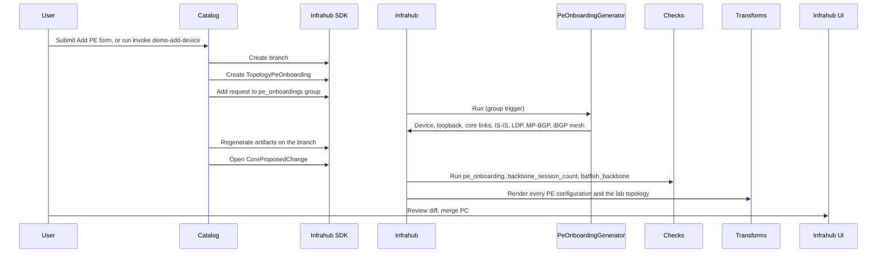

# Add a PE router

This page documents PE onboarding end-to-end: how an operator adds a PE
router to the MPLS backbone, either from the Streamlit catalog or with the
`invoke demo-add-device` command, what Infrahub does automatically, which
checks gate the merge, and how to boot the new router in the lab before and
after the merge.

For field-level schema details see [schema-reference](../schema-reference.mdx).

---

## Run the demo from the command line

`invoke demo-add-device` does what the catalog's **Add PE** page does, in the
same order, without the browser. It is the quickest way to show the whole
change workflow: request a router, review the proposed change, boot it in the
lab, merge.

```bash
uv run invoke demo-add-device
```

With no options the command picks values that work on either dataset:

| Option | Default | Example on the financial dataset |
|---|---|---|
| `--name` | The next free `pe-NN` name | `pe-09` |
| `--uplinks` | The first two PEs of the backbone, by name | `pe-01,pe-02` |
| `--platform` | `arista_eos`, the platform the lab can boot | `arista_eos` |
| `--site` | The site of the first uplink | `lon` |
| `--device-type` | The device type of the first uplink | `7280R3` |
| `--branch` | `backbone/add-pe-<name>-<random suffix>` | `backbone/add-pe-pe-09-5f5bcbda` |

Name any of them to override the default:

```bash
uv run invoke demo-add-device --name pe-10 --uplinks pe-02,pe-05
```

The command applies the same rules as the catalog form before it creates
anything: a new name, two to four distinct uplinks on one backbone, and a
platform with a PE configuration artifact. It then opens the branch, waits for
the generator, renders the branch's artifacts and opens the proposed change.
On the financial dataset this takes about 30 seconds. It ends with the link to
the proposed change and the command that boots the change in the lab:

```text
✓ Proposed change opened
Review the proposed change:
  http://localhost:8000/proposed-changes/18defee2-946e-b2cc-2fb1-10653a0c4c3e
Boot it in the lab before merging:
  uv run invoke lab.deploy --branch backbone/add-pe-pe-09-5f5bcbda
```

The link uses `INFRAHUB_UI_URL` from `.env`. Set it to the address you open
Infrahub at when that is not `localhost`.

To continue the demo:

1. Open the link and review the proposed change: the new device, the iBGP
   session added on every other PE, and the configuration diffs.
2. Wait for the checks to pass. See [Checks](#checks).
3. Run the `lab.deploy --branch` command to boot the change in containerlab.
   See [Boot the new PE in the lab](#boot-the-new-pe-in-the-lab).
4. Merge the proposed change in the Infrahub UI.

Each run takes the new router's loopback and core-link addresses from the
same pools that every branch shares. If an earlier demo branch is still open,
a new branch for the same name gets the next free addresses: a second `pe-09`
gets loopback `10.0.0.10` while the first one holds `10.0.0.9`. Merge or
delete old demo branches to keep the addresses predictable.

If the generator does not finish within 300 seconds (set
`GENERATOR_WAIT_TIME` to change this), the command stops without rendering
artifacts or opening a proposed change, keeps the branch for inspection and
exits with a non-zero status.

---

## User flow



### Step-by-step

1. **Catalog form**: the operator names the new router, picks its backbone,
   site, platform and device type, and selects at least two existing PEs as
   uplinks. The form rejects a name that already exists, fewer than two
   distinct uplinks, or an uplink outside the chosen backbone.
   Only platforms with a PE configuration artifact are offered: Arista EOS,
   Cisco IOS-XR, Juniper Junos and Nokia SR OS. `invoke demo-add-device`
   applies the same rules to its options, and fills in any option you leave
   out with the defaults listed above.

2. **Branch and request**: the catalog, or the command, opens a branch named
   `backbone/add-pe-<name>-<id>` and writes one `TopologyPeOnboarding` row
   with `status = draft`.

3. **Generator run (event-driven)**: the catalog then adds the request to the
   `pe_onboardings` group. That membership change fires `trigger-pe-generator`
   (`objects/events/00_triggers.yml`), which runs `PeOnboardingGenerator`
   on the branch. Like `generate_l3vpn`, the generator is kept out of the
   proposed-change pipeline (`execute_in_proposed_change: false`), because in
   the pipeline it races artifact rendering and the proposed change shows no
   configuration diff.

4. **Proposed change**: once the generator has linked the device and written
   every core port and iBGP session, the catalog re-renders every artifact on
   the branch and opens a `CoreProposedChange` into `main`.
   If generation times out, the catalog stops and preserves the branch for
   inspection. It does not render artifacts or open a proposed change for an
   incomplete PE.

5. **Checks**: the validators listed under [Checks](#checks) must pass.

6. **Lab test** (optional): `invoke lab.deploy --branch <branch>` boots the
   proposed change in the lab before it is merged. See
   [Boot the new PE in the lab](#boot-the-new-pe-in-the-lab).

7. **Merge**: the operator reviews the diff and merges. The new router appears
   in the lab built from `main` on the next `invoke lab.deploy`.

---

## Generator: what it creates

For a request with two uplinks on a backbone that already has N PEs, the
generator writes:

| Object | Count | Notes |
|---|---|---|
| `DcimDevice` | 1 | `role = pe`, backbone AS, request's platform, device type and site |
| `InterfaceVirtual` Loopback0 | 1 | Address allocated from `pe_loopback_pool` |
| `IpamPrefix` /31 | 2 | One per uplink, from `backbone_p2p_pool` |
| `InterfacePhysical` on the new PE | 2 | `Ethernet1`, `Ethernet2`, `role = core`, MTU 9000, in uplink name order |
| Spare `InterfacePhysical` on the new PE | 2 | `Ethernet3`, `Ethernet4`, `role = cust`, `status = free`, ready for L3VPN attachments or later backbone links |
| `InterfacePhysical` on each uplink PE | 1 each | The lowest `status = free` port, converted to `role = core` and described `To <new PE>` |
| `IpamIPAddress` | 1 + 4 | The loopback, then both ends of each /31 (new PE even, uplink odd) |
| `MplsIsisProcess`, `MplsLdpProcess`, `MplsBgpProcess` | 1 each | NET derived from the loopback, for example `10.0.0.9` becomes `49.0001.0100.0000.0009.00` |
| `RoutingBGPSession` | 2 x N | `<new> to <peer>` on the new PE and `<peer> to <new>` on every other PE of the request's backbone |
| Group membership | `pes`, `pe_<platform>` | So the configuration artifact definitions target the new router |
| Backbone membership | 1 | The device joins `TopologyMplsBackbone.pes`, so the lab topology includes it |

The sessions are created on both ends because the PE templates render
`RoutingBGPSession(device__name__value: $device)`: an existing PE only gains
the new neighbour in its configuration when it holds its own session row.

Rerunning the generator preserves any service or backbone link that has since
claimed a spare port. It does not reset those ports to `free`.

The generator links the request to the device as soon as it creates it. It
refuses a request whose name belongs to a device the request does not point
to, rather than adopting that device: an adopted device would be deleted along
with the request. The catalog form and `invoke demo-add-device` reject such a
name before a branch exists. The `pe_onboarding` check reports it for a request
loaded from YAML or created in the web UI.

No transform or template changes are needed. The containerlab transform
derives backbone links from the core ports that share a /31, and the artifact
definitions already target the groups the device joins.

---

## Checks

| Check | Target | What it rejects |
|---|---|---|
| `pe_onboarding` | `pe_onboardings` | Incomplete generation (status, linked device, backbone membership, core-port and iBGP-session counts), a name already used by a device the request did not create, fewer than two distinct uplinks, the router as its own uplink, an uplink that is not a PE of the backbone, or an uplink with no free port left |
| `backbone_session_count` | `pes` | Any PE with fewer than N-1 iBGP sessions after the change, which is what a missing reverse session looks like |
| `batfish_backbone` | `topologies_mpls` | Configurations Batfish cannot parse, IS-IS adjacencies that do not form between the rendered configurations, or incompatible BGP sessions |

---

## Boot the new PE in the lab

Before the merge, deploy the proposed change's source branch. The catalog
and `invoke demo-add-device` both print the full command, with the branch
name, when they open the proposed change. After the merge, run the same
command without `--branch` to deploy from `main`.

`invoke lab.deploy` tears the whole lab down and boots every node again:
containerlab has no way to add a node to a running lab. With nine PEs, allow
several minutes for EOS to come up, and expect any collector that reads the
lab by container address to re-discover everything.

```bash
uv run invoke lab.deploy --branch backbone/add-pe-pe-09-5f5bcbda
containerlab exec -t lab/mpls-backbone.clab.yml --label clab-node-name=pe-09 \
  --cmd "show bgp summary"
containerlab exec -t lab/mpls-backbone.clab.yml --label clab-node-name=pe-09 \
  --cmd "show isis neighbors"
```

Expected: every other PE listed as an established iBGP neighbour, and one
IS-IS adjacency per uplink. The customer hosts behind the CE routers still
reach the other site of their own VPN, and not the other VPN:

```bash
docker exec clab-mpls-backbone-1-cust-trading-lon ping -c 3 10.200.20.10   # trading Zurich: replies
docker exec clab-mpls-backbone-1-cust-trading-lon ping -c 3 10.200.40.10   # IB Zurich: no reply
```

---

## Known limitations

- **Changing a request's uplinks after generation is not supported.** The port
  the generator claimed on an uplink PE belongs to that PE, so the generator
  never un-claims it. Delete the request and open a new branch instead.
- **Onboard one PE at a time.** The generator reads only its own branch. Two
  requests open on separate branches can claim the same free port on a shared
  uplink PE, and neither new PE gets an iBGP session to the other. The checks
  evaluate each branch on its own, so both proposed changes pass. Merge one
  proposed change before you open the next request.
- **A device name can be used only once.** The generator stops with an error
  when a device with the request's name already exists and the request did not
  create it, instead of adopting that device.
- **A decommissioned request is no longer validated.** Setting a request's status
  to `decommissioned` skips it in the `pe_onboarding` check. It does not remove
  the device or its links.
- **Management addresses are not pinned.** The containerlab topology lets
  containerlab assign management addresses, so adding a node can shift the
  address an external collector was configured with.
- **The iBGP mesh grows quadratically.** Nine PEs means 72 session rows. A
  route reflector model is the natural next step and is not part of this flow.

---

## Rolling out to an instance that already runs this repository

The repository sync delivers `.infrahub.yml` content only: the generator, the
check and the queries. Schema, menu and object files are loaded by
`invoke bootstrap`, so an instance that was bootstrapped before this feature
needs them loaded by hand after pulling the commit:

```bash
uv run infrahubctl schema load schemas/
uv run infrahubctl menu load menus/menu.yml
uv run infrahubctl object load objects/55_groups.yml
# Wait until the CoreRepository reports in-sync, so generate_pe exists.
uv run infrahubctl object load objects/events/00_triggers.yml
INFRAHUB_SERVICE_CATALOG=true uv run invoke start   # rebuilds the catalog container
```

All four loads are idempotent.

One more thing to check on an instance whose repository carries branches that
predate this change. The repository sync creates an Infrahub branch per git
branch and deletes the `pe_onboarding` check definition on every branch whose
`.infrahub.yml` does not declare it. Infrahub 1.11.7 then refuses to create
the `Check: pe_onboarding` validator on any branch, so the check is silently
missing from every proposed change (the task-worker log shows
`Unable to find the node <id> / CoreCheckDefinition`). Delete those stale
Infrahub branches, or bring the git branches up to date, and the check runs
again. The other validators are unaffected.
