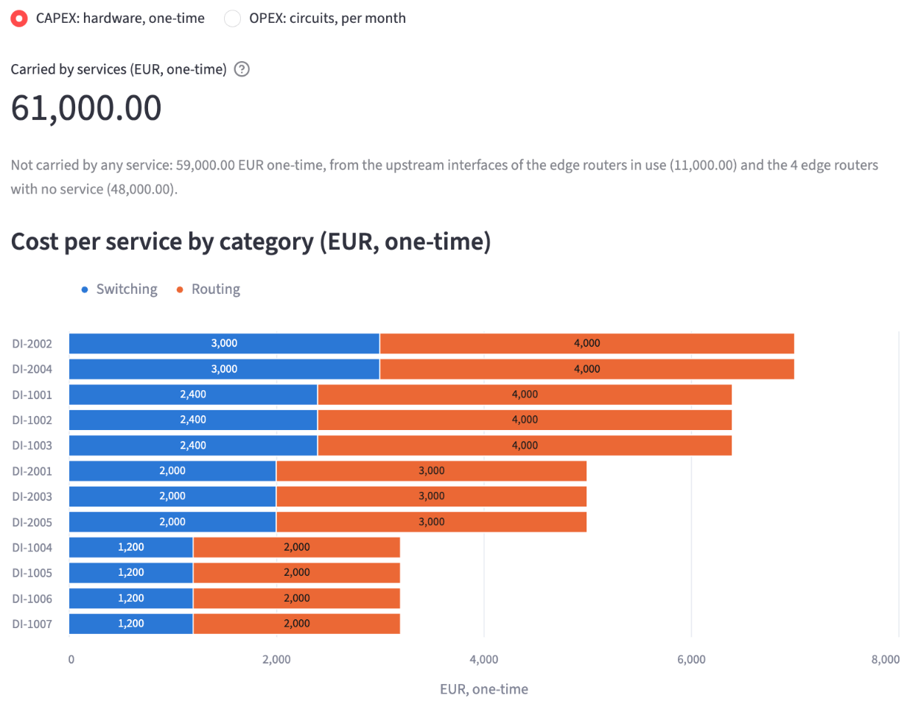
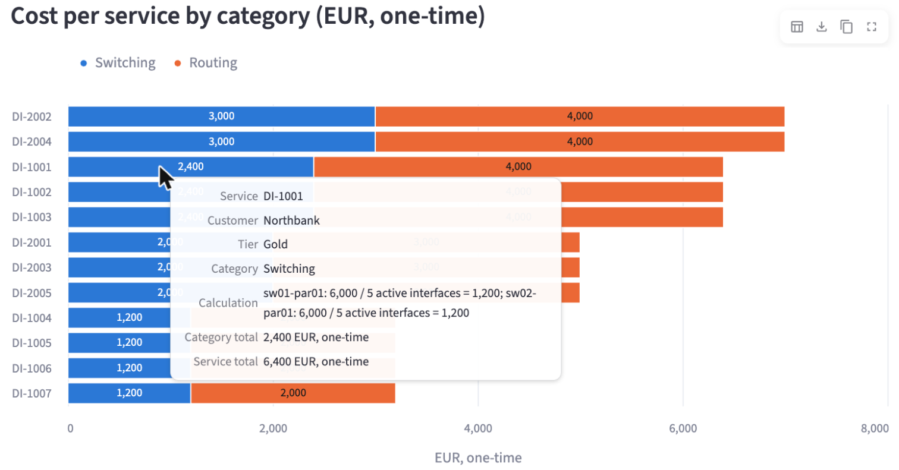
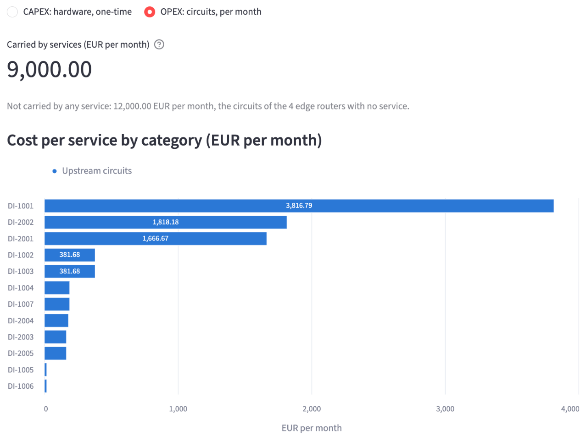
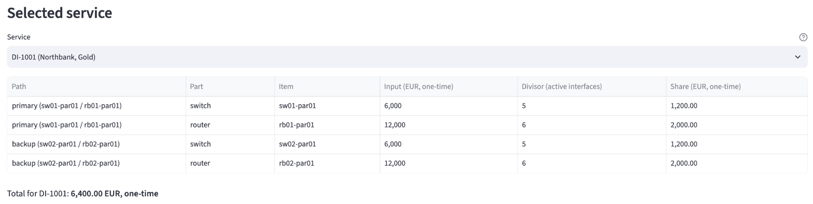
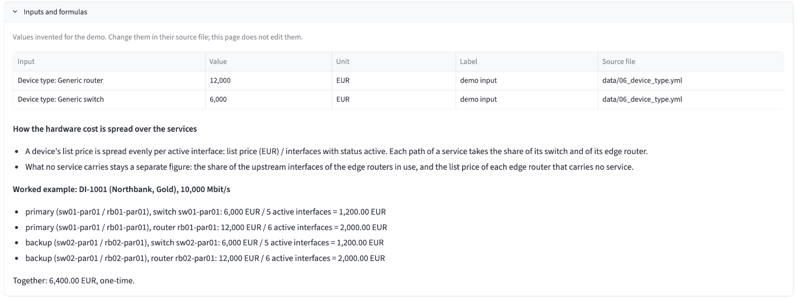
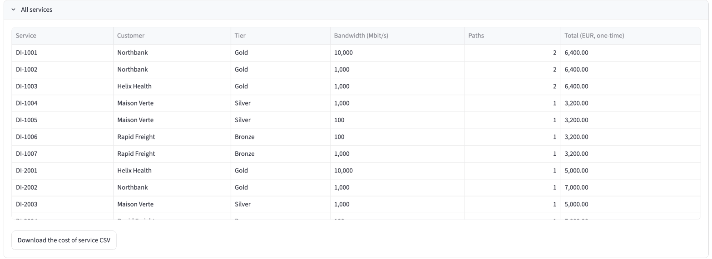

# View what each service costs to deliver

An economic buyer asks what one service costs to deliver, and what all services cost together. In this demo, the cost of a service follows its paths through the network: each service takes a share of each switch, edge router and upstream circuit it uses. The Cost of service page shows these shares, and Infrahub generates the same figures as a CSV file that the buyer downloads.

Every input is a demo input: a list price for each device type and a monthly cost for each upstream circuit. The values are invented for the demo and labelled "demo input" in their files.

## Why cost belongs next to the network model

The parts a service uses are already in the source of truth: its switch ports, its gateway interfaces, the devices behind them and the circuits on those devices. When the cost inputs sit on the same nodes, the cost of a service is computed from the network as it is, not from a separate spreadsheet that someone keeps in step with the network. A service that gains a second path, or a device that carries more services, changes the figures with no extra work.

## Before you begin

Install the demo and run the optional seed step, as described in the [installation guide](../getting-started/installation.mdx). The seed step loads the upstream circuits and generates the "Cost of service" artifact on the current network.

## The two units: CAPEX and OPEX

The page shows one unit at a time. Select it with the **Cost** switch at the top of the page:

- **CAPEX: hardware, one-time**: the share of each switch and edge router list price, in EUR, paid once
- **OPEX: circuits, per month**: the share of each upstream circuit, in EUR per month

The page never adds the two units together. A one-time amount and a monthly amount can only be added after the hardware cost is spread over a number of months, and the demo does not model that period.

## View the hardware cost of every service

Open the portal at `http://localhost:8501` and select **Cost of service** under **Business impact** in the sidebar, or the **💶 Cost of service** card on the home page. The page opens on **CAPEX: hardware, one-time**.



The page shows:

- **Carried by services (EUR, one-time)**: 61,000.00, the sum of the hardware shares of every service
- The cost no service carries, as its own sentence: 59,000.00 EUR one-time. It is made of the share of the upstream interfaces of the edge routers in use (11,000.00), and the list price of the 4 edge routers with no service (48,000.00). It is never spread over the services.
- **Cost per service by category (EUR, one-time)**: one bar per service, split into **Switching** and **Routing**, with the value of each part inside the bar

Hover over a part of a bar to view its calculation. For DI-1001, the **Switching** part shows each switch with its list price, its active interfaces and its share, and the totals for the category and the service:



## View the circuit cost of every service

Select **OPEX: circuits, per month**.



The page shows:

- **Carried by services (EUR per month)**: 9,000.00, the sum of the circuit shares of every service
- The cost no service carries: 12,000.00 EUR per month, the circuits of the 4 edge routers with no service
- **Cost per service by category (EUR per month)**: one bar per service, for the **Upstream circuits** category

DI-1001 carries the largest circuit share, 3,816.79 EUR per month, because it has 10,000 Mbit/s of bandwidth on two paths.

## View the paths of one service

Under **Selected service**, select a service in **Service**. The table lists each path of the service and each part on it, with the input, the divisor and the share, in the unit selected at the top of the page. With CAPEX selected, DI-1001 (Northbank, Gold) shows four rows:



- The primary path, through `sw01-par01` and `rb01-par01`: 6,000 / 5 = 1,200.00 for the switch and 12,000 / 6 = 2,000.00 for the router
- The backup path, through `sw02-par01` and `rb02-par01`: the same shares on the other switch and router

A backup path is counted in full and listed as its own rows. The total for DI-1001 is 6,400.00 EUR one-time. With OPEX selected, the same table lists the circuit of each path, and the total is 3,816.79 EUR per month.

## The formulas

The page uses actual utilization: the interfaces and the bandwidth in use on the network today, not planned utilization. It shows no depreciation, forecast or budget. Only active services take a share, as on the other business impact pages.

The share of a device for one path of a service is:

```text
device share (EUR, one-time) = list price of the device type / interfaces of the device with status active
```

A busier device has more active interfaces, so each service pays a smaller share of it. Each edge router also has one active upstream interface, `Ethernet4`, where its circuit lands. That interface carries no service, so its share stays in the cost no service carries.

The share of a circuit for one path of a service is:

```text
circuit share (EUR per month) = monthly cost of the circuit x bandwidth of the service / bandwidth of every service path through the circuit's edge router
```

A service's hardware share is the sum of the device shares over every device on every path. Its circuit share is the sum of the circuit shares over every path.

For DI-1001, 10,000 Mbit/s, the circuit share of each path is 2,500 x 10,000 / 13,100 = 1,908.40 EUR per month, because 13,100 Mbit/s of service paths run through each Paris edge router. Together: 3,816.79 EUR per month.

## Read the inputs and formulas on the page

Open **Inputs and formulas** at the bottom of the page. It lists each input of the selected unit with its value, unit, the label "demo input" and the file it comes from. It also states how the cost is spread over the services and gives a worked example for DI-1001.



The page has no input to edit. To change a value, change it in its source file in the repository.

The demo inputs are:

| Input | Value | Source file |
|---|---|---|
| List price of the Generic router device type | 12,000 EUR | `data/06_device_type.yml` |
| List price of the Generic switch device type | 6,000 EUR | `data/06_device_type.yml` |
| Monthly cost of each Paris upstream circuit (COG-PAR-TR-1001, COLT-PAR-TR-2,001) | 2,500 EUR | `data/business_impact/upstream_circuits.yml` |
| Monthly cost of each Brussels upstream circuit (ZAYO-BRU-TR-1001, COLT-BRU-TR-2,001) | 2,000 EUR | `data/business_impact/upstream_circuits.yml` |
| Monthly cost of each New York and Dallas upstream circuit (COG-NYC-TR-1001, LUMEN-NYC-TR-2001, ZAYO-DAL-TR-1001, LUMEN-DAL-TR-2,001) | 3,000 EUR | `data/business_impact/upstream_circuits.yml` |

## Where cost sits in the model

The device cost is a list price on the device type, `list_price` on `DcimDeviceType`. Every device already links to its device type, so the model gains one optional attribute, and the device itself does not change. Two values cover the 16 devices of the demo. A team that tracks the price paid for each unit can add an attribute on the device instead.

The circuit cost is `monthly_cost` on `DcimCircuit`. The circuit contract node holds the contract dates and the signed document, so the cost sits on the circuit, next to its circuit ID. Endpoint A of each upstream circuit connects to `Ethernet4` of its edge router, which is how the cost reaches the services that run through the router. Infrahub path traversal follows this link from each service, through its gateway interface and edge router, to the circuits at its site.

The circuit schema is optional: `.infrahub.yml` leaves `schemas/circuit` commented out, so the repository import does not load it. `invoke seed` loads the circuit schema and the eight upstream circuits from `data/business_impact/upstream_circuits.yml`. Until then, the page shows the hardware cost only, and **OPEX: circuits, per month** says that it needs the circuit schema. The CSV file then has no circuit rows.

Both attributes are optional, and their descriptions say "demo input".

## Download the figures as a CSV file

Open **All services**. The table lists each service with its customer, tier, bandwidth, number of paths and total in the selected unit. Below it, select **Download the cost of service CSV**.



The browser saves `cost-of-service.csv`. The file is the "Cost of service" artifact that Infrahub generates on the current network; the page does not build its own copy. It has one row per service, path and part, in both units:

```csv
service,customer,tier,path,part,item,input,divisor,method,share,unit,note
DI-1001,Northbank,Gold,primary (sw01-par01 / rb01-par01),switch,sw01-par01,6000,5,per active interface,1200.00,EUR one-time,
DI-1001,Northbank,Gold,primary (sw01-par01 / rb01-par01),router,rb01-par01,12000,6,per active interface,2000.00,EUR one-time,
DI-1001,Northbank,Gold,primary (sw01-par01 / rb01-par01),circuit,COG-PAR-TR-1001,2500,13100,by bandwidth,1908.40,EUR per month,
```

A row whose share cannot be computed has an empty `share` and says why in `note`: `no list price`, `no active interfaces`, `no circuit`, `no monthly cost` or `no service bandwidth`. The page leaves these rows out of its totals and says how many it left out.

The `unit` column keeps the one-time and monthly rows apart, so a spreadsheet or reporting tool can total each unit on its own. In Infrahub, the same file is under **Object Management**, then **Artifacts**, as `cost-of-service`.

### When the CSV file is older than the page

Infrahub generates the CSV file again when a device, an interface or a service that the cost query returns changes. A change to an upstream circuit, such as its monthly cost, does not regenerate the file. The page computes its figures from the current data each time it loads, so it compares them with the CSV file in Infrahub:

- When the file has other figures, the page says "The file in Infrahub is older than the figures on this page".
- When Infrahub has not generated the file yet, the page says "The cost of service CSV is not generated yet".

In both cases, select **Regenerate**. Infrahub generates the file again on the current network, and the page waits for the new file, then loads again with the notice gone. If Infrahub cannot generate the file, the page says so, and the Infrahub task log has the details.
