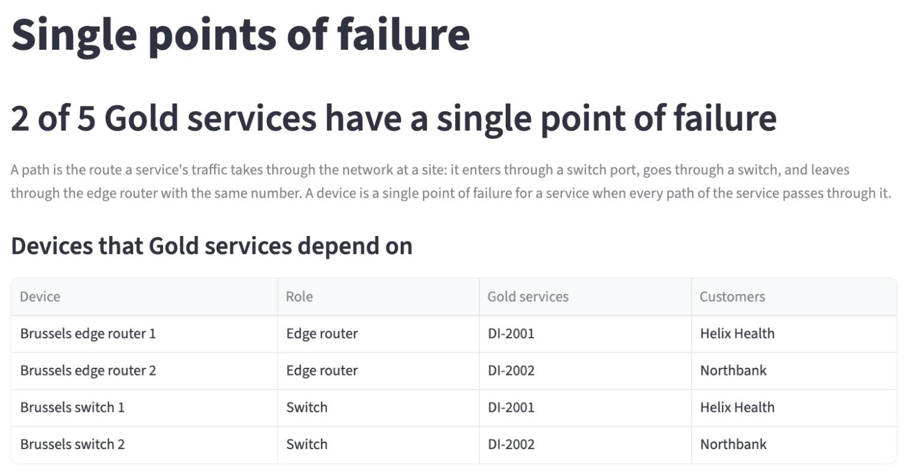
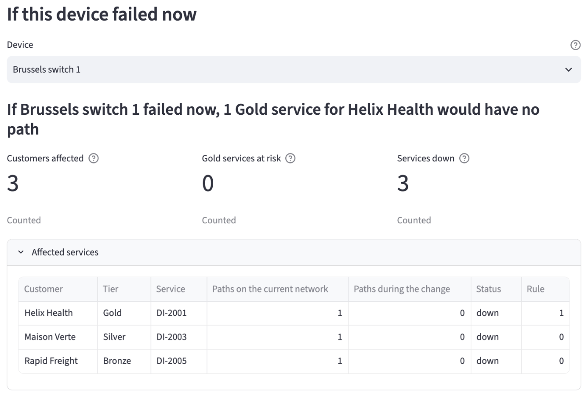

# Find the Gold services that depend on a single device

The Single points of failure page lists the switches and edge routers whose failure would leave Gold services with no path on the current network. It shows you which Gold services need a second path. The page only reads the current network.

## Why a Gold service on a single device is a risk

Gold services keep at least 1 separate path during a change, so that maintenance or a failure on one device does not stop them. The network does not always deliver that: a Gold service can depend on a single switch or edge router, and nobody notices until that device fails or is scheduled for maintenance. This page lists those services on the current network, so you can decide which second paths to build before a device fails. If a device fails without warning, the same page shows which customers lose service.

## Before you begin

Install the demo and run the optional seed step, as described in the [installation guide](../getting-started/installation.mdx). For what counts as a path and a single point of failure, read the [business impact overview](overview.mdx#single-points-of-failure).

## View the Gold services with a single point of failure

Open the portal at `http://localhost:8501` and select **Single points of failure** under **Business impact** in the sidebar, or the **📍 Single points of failure** card on the home page.

The headline shows how many active Gold services have a single point of failure:

> 2 of 5 Gold services have a single point of failure

The table **Devices that Gold services depend on** lists each switch and edge router that is on every path of at least one Gold service. For each device, it shows the role, the Gold services and the customers.

The table lists the four Brussels devices. DI-2001 (Helix Health) depends on Brussels switch 1 and Brussels edge router 1, and DI-2002 (Northbank) depends on Brussels switch 2 and Brussels edge router 2. Each of these services has one path.

No Paris device is in the table. The Paris Gold services DI-1001, DI-1002 and DI-1003 each have two paths, one through each switch and edge router pair at the site. A failure of one Paris device leaves each of them one path.

## View what would have no path if a device failed now

Under **If this device failed now**, select a device in **Device**. The list holds the devices from the table. The page sets that device to not active in a copy of the current network, and shows the same figures as the Planned maintenance page: a headline, the three tiles and the affected services.

Select Brussels switch 1. The headline shows "If Brussels switch 1 failed now, 1 Gold service for Helix Health would have no path". The tiles show 3 customers affected, 0 Gold services at risk and 3 services down. **Affected services** lists DI-2001 (Helix Health, Gold), DI-2003 (Maison Verte, Silver) and DI-2005 (Rapid Freight, Bronze), each with 1 path on the current network and 0 after the failure.

## Decide which Gold services need a second path

A Gold service keeps a path after one device fails only when it has a second path, through another switch and edge router at the site. The Paris Gold services already have one. The services in the table, DI-2001 and DI-2002, are the ones to give a second path.

Until a Gold service has a second path, a planned change on one of its devices is blocked by the Gold outage guard, as the Brussels switch 1 plan in [Plan maintenance that keeps Gold services in service](plan-maintenance.mdx#step-5-read-why-the-brussels-plan-is-blocked) shows.
