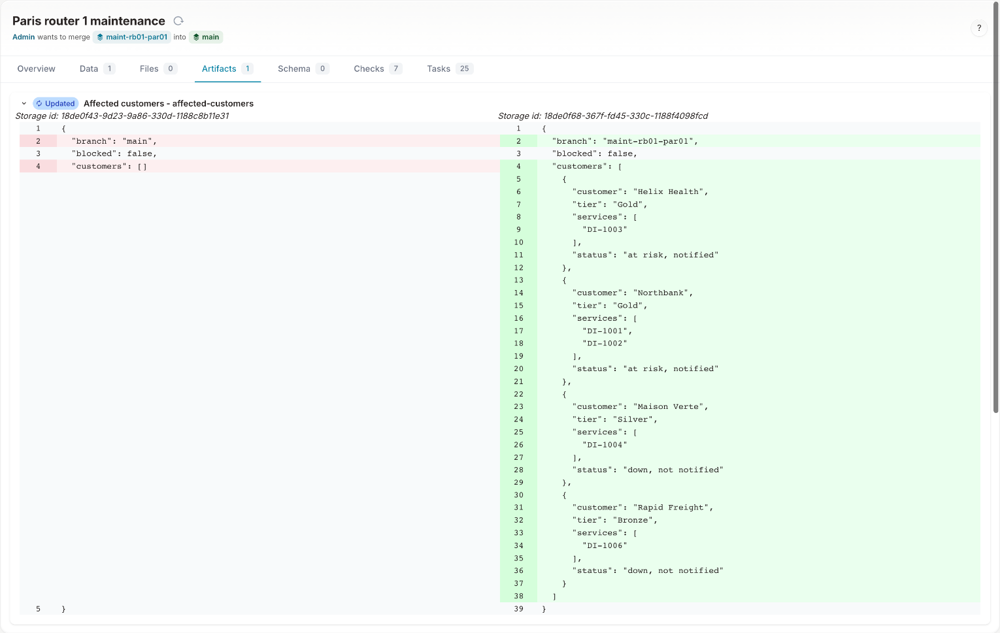
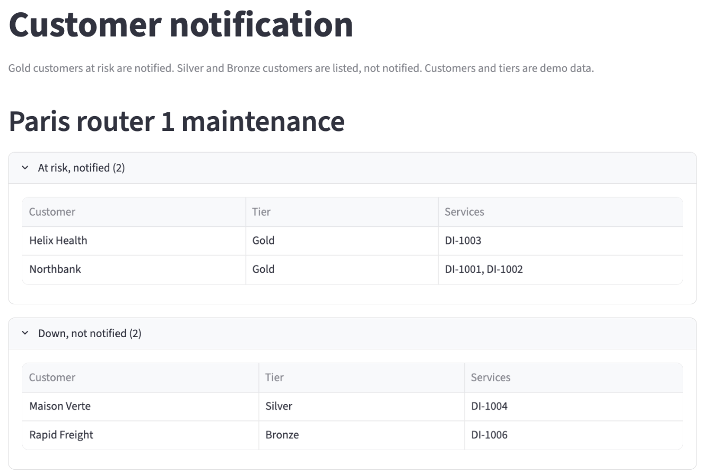
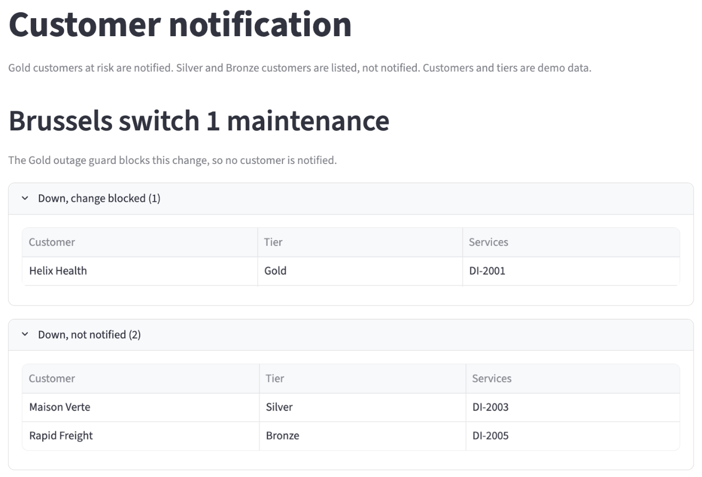
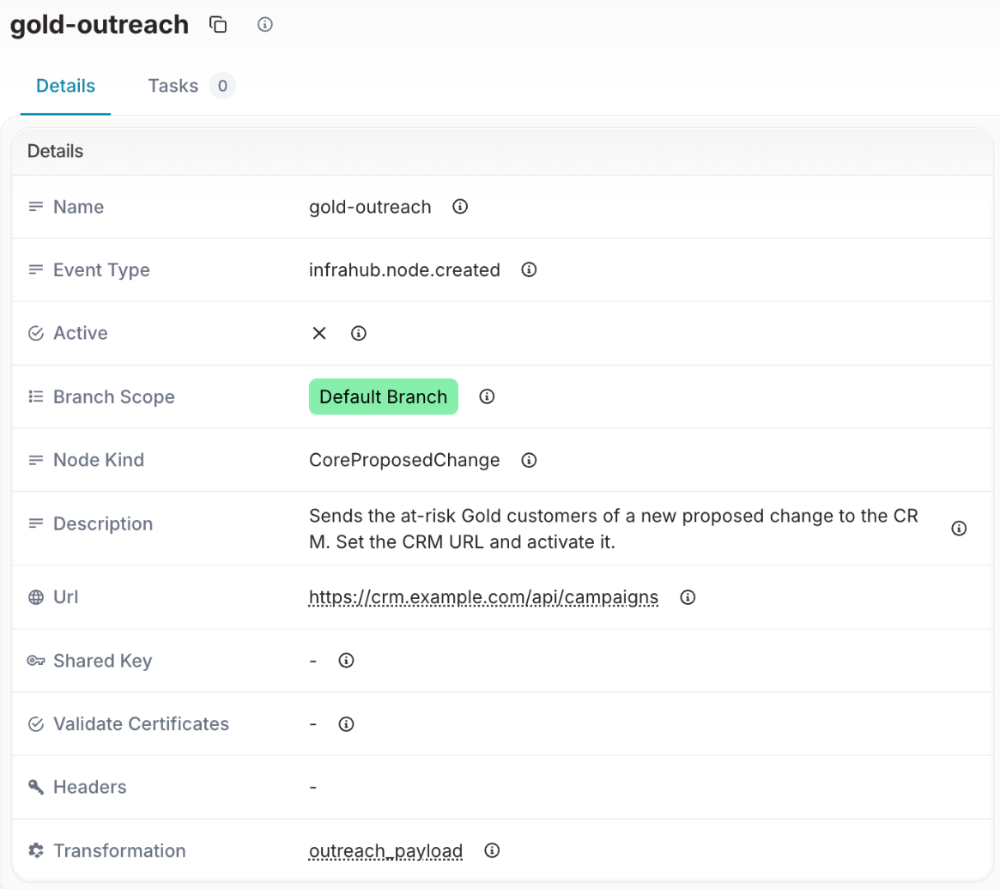
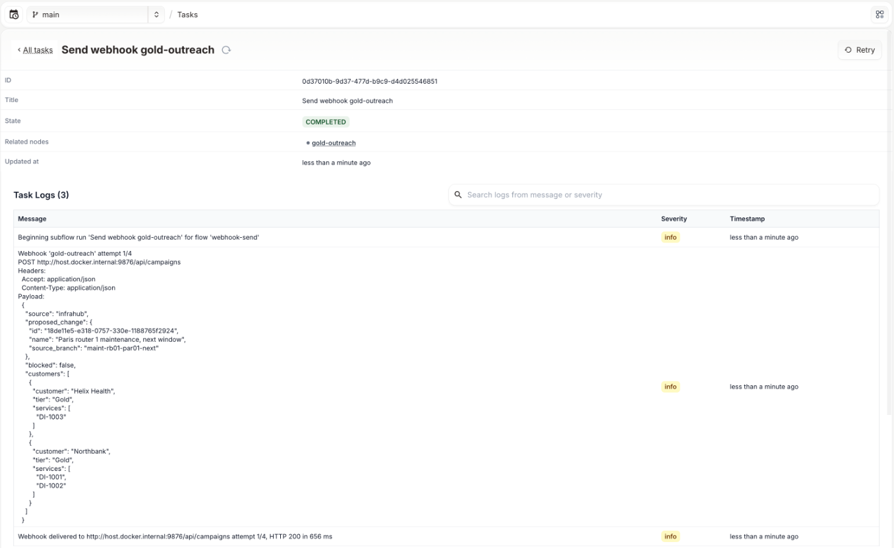

# Notify the Gold customers a change puts at risk

When you plan maintenance, two groups of customers need different handling:

- Gold customers whose services keep a path during the change are at risk. The team notifies them, for example with an outreach campaign from the CRM.
- Silver and Bronze customers whose services go down are listed, but not notified. Their tiers allow announced maintenance to take the service down.

Infrahub produces the list of affected customers for each proposed change as an artifact. The Customer notification page in the portal shows that list, grouped by status. A webhook in Infrahub sends the at-risk Gold customers of a new proposed change to the CRM. The demo runs no CRM: the webhook is set up but not active.

## Why the notification list comes from the source of truth

The list of customers to notify depends on which services run through the devices in the change, and on how many separate paths each service keeps. Both are in the network model. When the list is built from the same data as the Gold outage guard, the team notifies the customers the change affects, no more and no fewer, and a change that the guard blocks notifies nobody.

## Before you begin

Install the demo and run the optional seed step, as described in the [installation guide](../getting-started/installation.mdx). The seed step opens the three maintenance proposed changes and creates the `gold-outreach` webhook. For what "at risk" and "down" mean, see the [business impact overview](overview.mdx#paths-and-when-a-service-is-at-risk-or-down).

## The statuses in the list

Each affected customer gets one row per tier, with its affected services and one of these statuses:

- **At risk, notified**: a Gold service keeps at least 1 path during the change, and the guard passes. The webhook sends this customer to the CRM.
- **Down, not notified**: a Silver or Bronze service has no path during the change.
- **Down, change blocked**: a Gold service has no path during the change. The guard blocks the change, so no customer is notified.

The list holds customer names, tiers and service identifiers only. Contact details stay in the CRM, which maps a customer and a tier to the people to write to.

## View the affected customers in Infrahub

Infrahub generates the "Affected customers" artifact on the branch of each proposed change, in the proposed change pipeline. The artifact is a JSON file.

Open Infrahub at `http://localhost:8000`, go to **Proposed Changes** and open "Paris router 1 maintenance". On the **Artifacts** tab, expand **Affected customers - affected-customers**. The left side is the artifact on the current network, which lists no customer. The right side is the artifact on the change's branch:



For the Paris change, the artifact lists four customers:

| Customer | Tier | Services | Status |
|---|---|---|---|
| Helix Health | Gold | DI-1003 | at risk, notified |
| Northbank | Gold | DI-1001, DI-1002 | at risk, notified |
| Maison Verte | Silver | DI-1004 | down, not notified |
| Rapid Freight | Bronze | DI-1006 | down, not notified |

## View the affected customers in the portal

Open the portal at `http://localhost:8501` and select **Customer notification** under **Business impact** in the sidebar, or the **📣 Customer notification** card on the home page. Select a proposed change in the **Proposed change** picker in the sidebar.

The page computes the affected customers of the selected change from the current data, with the same code as the "Affected customers" artifact, and shows them grouped by status.



Select "Brussels switch 1 maintenance". The page states that the Gold outage guard blocks this change, so no customer is notified. Helix Health (Gold, DI-2001) is down, change blocked. Maison Verte (Silver, DI-2003) and Rapid Freight (Bronze, DI-2005) are down, not notified.



Select "New York router 1 maintenance". No customer is affected by this change.

### When the artifact is older than the page

Infrahub generates the artifact again when a node of the change's services, devices or interfaces changes on the change's branch, and in each proposed change pipeline. A change merged into the current network, or a change to the links between interfaces, does not regenerate it. So the page compares its list with the artifact of the selected change and says when they differ:

- "The file in Infrahub is older than the figures on this page": the artifact lists other customers or statuses.
- "The file in Infrahub for this change is not generated yet": Infrahub has not finished generating the artifact for this change.
- An error that starts with "Generation failed": Infrahub could not generate the artifact. The Infrahub task log has the details.
- "The affected customers file in Infrahub could not be read": the artifact holds content the page cannot read.

In each case, select **Regenerate**. Infrahub generates the artifact again for the selected change, and the page waits for it, then loads again.

## The gold-outreach webhook

The `gold-outreach` webhook sends the at-risk Gold customers of a new proposed change to the CRM. In Infrahub, open **Integrations**, then **Webhooks**, and select `gold-outreach`.



The webhook has these settings:

- **Event Type**: `infrahub.node.created`, and **Node Kind**: `CoreProposedChange`. The webhook fires when a proposed change is created.
- **Branch Scope**: Default Branch. A proposed change is a node of the default branch, so its creation event belongs to `main`.
- **Transformation**: `outreach_payload`, a Python transform in this repository that builds the body the CRM receives.
- URL: `https://crm.example.com/api/campaigns`, a placeholder.
- **Active**: not active, so the demo sends nothing.

When the proposed change is created, the transform reads the change's source branch from the event, runs the Gold outage guard on that branch, and builds the body from the same affected customers list as the artifact:

- When the guard would pass, the body lists each Gold customer with at least one service at risk, with its tier and those services.
- When the guard would fail, the body has `blocked: true` and lists no customer.
- Silver and Bronze customers are never in the body.

## The payload the CRM receives for the Paris change

For "Paris router 1 maintenance", the CRM receives this body:

```json
{
  "source": "infrahub",
  "proposed_change": {
    "id": "18ddc738-3f0c-8af2-2d9f-118839da16ca",
    "name": "Paris router 1 maintenance",
    "source_branch": "maint-rb01-par01"
  },
  "blocked": false,
  "customers": [
    {
      "customer": "Helix Health",
      "tier": "Gold",
      "services": ["DI-1003"]
    },
    {
      "customer": "Northbank",
      "tier": "Gold",
      "services": ["DI-1001", "DI-1002"]
    }
  ]
}
```

For "Brussels switch 1 maintenance", which the guard blocks, the body has `"blocked": true` and an empty `customers` list. The `id` is the ID of the proposed change in Infrahub, so the CRM can link the campaign back to the change.

## Point the webhook at your CRM

To start an outreach campaign from your CRM when a proposed change is created:

1. In Infrahub, open the `gold-outreach` webhook and select **Edit**.
2. Set the URL to the endpoint of your CRM that accepts the body above, for example an endpoint that starts a campaign.
3. Set **Active** and save.

From then on, each new proposed change sends its at-risk Gold customers to the CRM. If the CRM cannot be reached, Infrahub records the failed delivery in its task log. The artifact and the Customer notification page do not depend on the webhook.

## Check that the CRM received the update

Each delivery is a task in Infrahub. To view it, open **Tasks** and filter on `webhook`, then open **Send webhook gold-outreach**. The task log shows the URL the webhook called, the body it sent, and the HTTP status the CRM returned.



In this delivery, the webhook pointed at an endpoint on the demo host, for a proposed change opened after the seed. The last log line, "Webhook delivered … HTTP 200", confirms that the endpoint accepted the body. A CRM that returns 200 has received the list of Gold customers for its outreach campaign.
