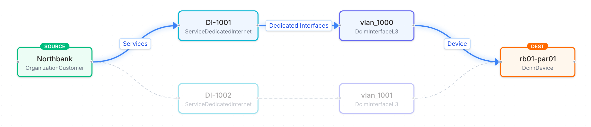

# Business impact

In this demo, each service is linked to its customer and its service tier, in the same Infrahub graph as the switch, edge router and IP resources the service runs on. Each tier carries one rule: the minimum number of separate paths its services keep during a change. Gold services must keep at least 1 separate path.

With that link in place, you plan a change by its effect on customers. Before a proposed change merges, the portal pages in this repository read the data from Infrahub and show which services the change puts at risk or takes down. Infrahub refuses to merge a plan that leaves a Gold service without a path. For which parts run in Infrahub and which run in the portal, see the [developer walkthrough](../getting-started/developer-walkthrough.mdx#what-runs-in-infrahub-and-what-runs-in-the-portal).

The business impact pages cover three separate tasks:

- [Plan maintenance that keeps Gold services in service](plan-maintenance.mdx): view which services a maintenance plan puts at risk or takes down, and view the Gold outage guard block a plan that leaves a Gold service with no path
- [Notify the Gold customers a change puts at risk](notify-gold-customers.mdx): view the list of affected customers for each proposed change, and send the at-risk Gold customers to a CRM with a webhook
- [View what each service costs to deliver](cost-of-service.mdx): view the hardware and circuit cost each service carries, built from the parts along its paths

The demo also has a page that lists the [Gold services that depend on a single device](find-single-points-of-failure.mdx) on the current network.

Infrahub draws the link between customers and devices from the stored data. In **Object Management**, **Path Traversal** from the customer Northbank to Paris edge router 1 finds two paths, one through each of the two services Northbank has there, DI-1001 and DI-1002, and their gateway interfaces on the router:

## Why business context belongs in the source of truth

Change review usually happens at the level of devices and interfaces. A maintenance window on an edge router looks the same whether a lab circuit or the main internet connection of your largest customer runs through the router. The people who plan and approve the change ask a different question: which customers depend on this device during the window, and which of them need another path to stay in service?

When customers and tiers are stored in a separate CRM or spreadsheet, someone answers that question manually, if at all, and usually after the window is scheduled. When they are stored in the same graph as the infrastructure, the answer is on the proposed change itself, built from the same data the automation already uses. The answer is part of the review, and you can enforce a rule such as "no plan may leave a Gold service without a path" as a check instead of a reminder.

Holding business intent in the same graph as the network changes how a team plans and approves a change:

- The impact of a change is computed from the data, not looked up. The Planned maintenance page and the Gold outage guard read the services, customers, tiers and devices from one stored query, on the proposed change and on the current network. Nobody has to match a list of devices against a list of customers by hand.
- A commitment becomes a rule that the network is checked against. Each tier records the minimum number of separate paths its services keep during a change. The guard reads that number and refuses to merge a plan that leaves a service below it. The rule is data in the model, where a reviewer can read it, not a value in the code of a check.
- A commitment changes through the same review as the network. Tiers and customers are branch-aware, so raising a tier's rule is a proposed change, like a maintenance plan. The guard checks the new rule against the current network before the merge, so the team cannot promise customers more separate paths than the network delivers.
- Every tool reads the same answer. The pages, the guard, the artifacts and the generator work from the same model. A portal, an ITSM tool, a CRM or a report can read the same stored query instead of keeping its own copy of which customer depends on which device.
- The record of a change includes its business context. Each service records who requested it and why. Each proposed change keeps the guard result, the list of affected customers, the approver and the merge time.

### The maintenance review, before and after

When customers and tiers are kept outside the source of truth, the review of a maintenance window usually takes these steps:

1. Export the devices the change touches.
2. Find the services that run on those devices in the inventory.
3. Look up the customer and the tier of each service in the CRM or a spreadsheet.
4. Decide which services need another path first, often after the window is already scheduled.
5. Write to the customers by hand.
6. Rely on the approver to remember which commitments the plan must keep.

With the business context in Infrahub, the same review takes these steps:

1. Open the proposed change. The Planned maintenance page shows the services at risk and the services down during the change, with their customers and tiers.
2. Read the Gold outage guard result. It checks the plan against each tier's rule and blocks the merge until the plan keeps the rule.
3. Read the affected customers list. The Gold customers at risk are the ones to notify, and a webhook can send them to the CRM.
4. Approve and merge. The proposed change keeps the guard result, the approver and the merge time.

## The business data

The demo schema adds two pieces of business data to every Dedicated Internet service. Both are demo inputs:

- Service tier: Gold, Silver or Bronze, stored as a `ServiceTier` node. Each tier has a minimum number of separate paths during a change: Gold 1, Silver 0 and Bronze 0.
- Customer: Northbank, Helix Health, Maison Verte or Rapid Freight, stored as an `OrganizationCustomer` node beside manufacturers and providers.

The customer and the tier are branch-aware. You can change them in a proposed change without changing the current network.

Each service in the demo data also records who requested it, in **Requested by**, and why, in **Reason for the request**. These two fields have the same value on every branch.

The cost of service page uses two more inputs, a list price per device type and a monthly cost per upstream circuit. [View what each service costs to deliver](cost-of-service.mdx#where-cost-sits-in-the-model) describes where they sit in the model.

## Where the business data comes from and where the results go

In the demo, a seed task loads the customers, tiers and request records. In production, this data is owned by other systems:

- Customers and tiers come from the CRM. Infrahub Sync, or a script that uses the Infrahub SDK, loads them into Infrahub and keeps them current, so each service links to the customer and tier the business systems hold.
- Service requests come from the order or ticketing system, which sets who requested the service and why when it creates the service.
- Results go back to the change process and the CRM. The proposed change holds the guard result, the approval and the merge. The affected customers artifact lists the customers of each change, and the `gold-outreach` webhook can send the at-risk Gold customers to the CRM when a proposed change is created. Contact details stay in the CRM.

The pages and the guard read only Infrahub. Replacing the seed data with data from these systems changes nothing in the pages, the guard or the stored query.

## Paths, and when a service is at risk or down

A path is the route a service's traffic takes through the network at a site. The traffic enters through a switch port, goes through a switch, and leaves through an edge router. At each site, a switch always connects to the edge router with the same number. For example, traffic that goes through Paris switch 1 always leaves through Paris edge router 1. So each path is one switch and its matching edge router.

To find the paths for a service, Infrahub starts at the service's switch ports and gateway interfaces. It follows the connections from there to the switches and edge routers they reach. The Gold outage guard, the portal pages and the cost of service all use the list of paths that Infrahub finds.

Three Paris Gold services, DI-1001, DI-1002 and DI-1003, have two paths: one through switch 1 and edge router 1, and one through switch 2 and edge router 2. If one path fails, their traffic can still use the other. Every other service has one path.

A path is out of service during a change when its switch or its edge router has any status other than active on the proposed change. Maintenance, provisioning and drained all count as out of service. Interface status is not considered.

Each active service affected by a change gets one of two statuses:

- At risk: the service has fewer separate paths during the change than on the current network, and at least 1 left.
- Down: the service has no path left during the change.

Every figure on the Planned maintenance page is counted from the network model: services, customers, tiers and separate paths.

## The Gold outage guard

The Gold outage guard is a check in the proposed change pipeline. It reads the same data as the Planned maintenance page. For each active service, it counts the separate paths the service keeps during the change and compares that number with the rule of the service's tier.

The guard reads the rule of each tier on the proposed change's branch and on the current network. In the demo data, Gold has 1, Silver 0 and Bronze 0. A rule of 0 means that announced maintenance may take a Silver or Bronze service down. The guard applies the rule of every tier. Its name comes from Gold, the only tier with a rule above 0 in the demo data.

For each proposed change, the result is:

| Situation | Result |
|---|---|
| An active Gold service has no path left during the change | Fails |
| The proposed change deletes the switch or edge router of an active Gold service, or removes its switch port or gateway interface, and the service has no other path | Fails |
| The proposed change raises a tier's rule and active services of that tier have fewer separate paths | Fails |
| Every active Gold service keeps at least 1 separate path, even if it has fewer than on the current network | Passes |
| A Gold service's device was already out of service on the current network | Passes, and logs a message naming the service |
| Only Silver or Bronze services are affected, or none | Passes |

When the plan leaves a service with fewer separate paths than its tier's rule, the message names the customer, the tier, the service and its paths before and after the change, and ends with the rule, for example "Gold requires at least 1 separate path during a change, and this change leaves 0." When the proposed change raises a tier's rule, the message names the services with fewer paths than the new rule, with the number of paths each one has. For a rule raised from 0, it ends with "Build the paths first, or keep the rule at 0."

Infrahub does not merge a proposed change while a check has failed. The guard has no override: no tag, setting or role allows the change to merge. To merge, the plan must leave every Gold service at least 1 path, for example by building a second path for the service first.

## Single points of failure

A device is a single point of failure for a service when every path of the service passes through it. A Paris Gold service has two paths, so no single Paris device is a single point of failure for it. A Brussels Gold service has one path, its switch and its edge router, so each of those two devices is a single point of failure for it.

The Single points of failure page shows this for the current network, without a proposed change. It counts the active Gold services with a single point of failure, lists the devices they depend on, and shows what would have no path if a selected device failed now. For the selected device, it uses the same rule and figures as the Planned maintenance page, on a copy of the current network with that device not active. The page only reads data from Infrahub.

## The record of a proposed change

Infrahub keeps a record of each proposed change:

- The plan: the proposed change's description, and its **Data** tab before the merge
- The guard result: the Gold outage guard's conclusion and message on the **Checks** tab
- The affected customers: the "Affected customers" artifact on the **Artifacts** tab
- Who approved it and when: **Approved by** on the proposed change, and the approval and merge with their dates on the **Activities** page

Infrahub refuses an approval from the account that opened the proposed change. In the demo, `admin` opens the plans, and Emma, the change manager account, approves them.

The demo runs on Infrahub Community. Infrahub records Emma's approval and refuses an approval from the account that opened the proposed change, but does not require an approval before merge. The Gold outage guard is what blocks a plan that fails the rule. Infrahub Enterprise can require approvals before merge.

The parts of this demo by Infrahub edition:

| Part of the demo | Infrahub Community | Infrahub Enterprise |
|---|---|---|
| Business data, branches and proposed changes | Yes | Yes |
| The Gold outage guard check and the refused merge | Yes | Yes |
| The affected customers and cost of service artifacts | Yes | Yes |
| The outreach webhook and its transform | Yes | Yes |
| The record of the approval, the check result and the merge | Yes | Yes |
| Refusing an approval from the account that opened the proposed change | Yes | Yes |
| Requiring approvals before merge | No | Yes |
| Revoking approvals when the branch changes after approval | No | Yes |

To load the demo data, run the optional seed step in the [installation guide](../getting-started/installation.mdx#step-6-seed-the-business-impact-demo-optional).

## In this section

- [Plan maintenance that keeps Gold services in service](plan-maintenance.mdx): Plan maintenance on Paris edge router 1, view the Gold services at risk on one path, and view the guard block the Brussels switch 1 plan
- [Find the Gold services that depend on a single device](find-single-points-of-failure.mdx): View which Gold services have a single point of failure, and what would have no path if a switch or edge router failed now
- [Notify the Gold customers a change puts at risk](notify-gold-customers.mdx): View the affected customers of each proposed change, and the webhook that sends the at-risk Gold customers to a CRM
- [View what each service costs to deliver](cost-of-service.mdx): View the hardware and circuit cost of each service, the inputs, the formulas and the CSV download
