# Plan maintenance that keeps Gold services in service

You plan maintenance on Paris edge router 1 (`rb01-par01`). The goal is that no Gold service loses its last path during the window, and that you know which customers the plan affects before anyone approves it. Gold customers have a second path so that maintenance on one router does not stop their service. Before the window is scheduled, you check which services depend on this router and how many separate paths each one keeps.

The demo data contains this plan as a proposed change named "Paris router 1 maintenance". It sets the router to maintenance on its own branch. Nothing has merged.

In Paris, the Gold services DI-1001 and DI-1002 (Northbank) and DI-1003 (Helix Health) each have two paths: one through Paris switch 1 and Paris edge router 1, and one through Paris switch 2 and Paris edge router 2. The Silver and Bronze services in Paris have one path. Maintenance on Paris edge router 1 leaves the Gold services on one path, at risk, and takes the Silver and Bronze services behind the router down.

## Why a maintenance plan needs a check on Gold services

Maintenance is usually reviewed device by device. The review shows the router, not the customers behind it, so the question "which customers lose service?" is answered manually, if at all, and often after the window is scheduled. Gold services have a second path so that maintenance on one router leaves them in service. The check matters where the network does not match that commitment: a plan that takes the only path of a Gold service out of service breaks it. In this tutorial, the proposed change shows the affected customers and their tiers before approval, and the Gold outage guard blocks the merge of a plan that leaves a Gold service with no path. For the reasoning behind storing business context in the same graph as the network, see the [business impact overview](overview.mdx#why-business-context-belongs-in-the-source-of-truth).

## Before you begin

Install the demo and run the optional seed step, as described in the [installation guide](../getting-started/installation.mdx). The seed step creates twelve services in Paris and Brussels, gives the three Paris Gold services a second path, and opens three maintenance proposed changes:

- "Paris router 1 maintenance" sets `rb01-par01` to maintenance
- "Brussels switch 1 maintenance" sets `sw01-bru01` to maintenance
- "New York router 1 maintenance" sets `rb01-nyc01` to maintenance; no active service runs through it

The seed step loads the customers and tiers as demo data. In production, this data comes from the CRM, as [Where the business data comes from](overview.mdx#where-the-business-data-comes-from-and-where-the-results-go) describes.

For what a path is and when a service counts as at risk or down, see the [business impact overview](overview.mdx#paths-and-when-a-service-is-at-risk-or-down).

## Step 1: check which services depend on the router

Open the portal at `http://localhost:8501` and select **Planned maintenance** under **Business impact** in the sidebar, or the **📊 Planned maintenance** card on the home page.

The Planned maintenance page is a small Streamlit app in this repository. It reads one stored query from Infrahub; Infrahub holds the data and enforces the Gold outage guard.

The **Proposed change** picker in the sidebar opens on "Paris router 1 maintenance". The headline shows:

> 3 Gold services for Helix Health and Northbank have fewer separate paths during this change

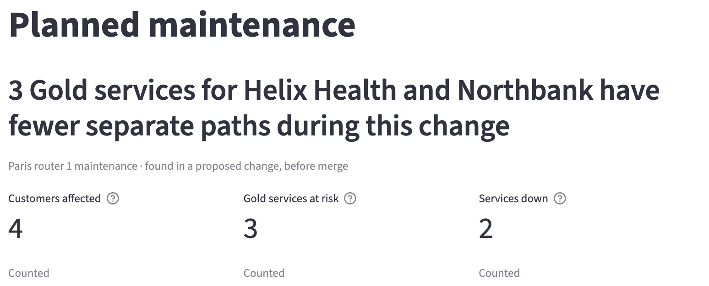

The three tiles below it show:

- Customers affected: 4, the customers with at least one active service at risk or down
- Gold services at risk: 3, the active Gold services with fewer separate paths during the change and at least 1 left
- Services down: 2, the active services with no separate path during the change

## Step 2: read which services are at risk and which are down

Open **Affected services** to view each service with its customer, tier, separate paths on the current network and during the change, status and tier rule.

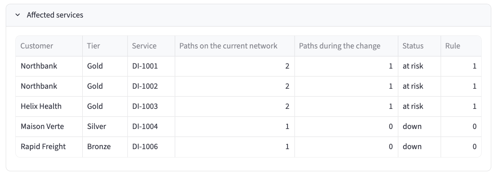

DI-1001 and DI-1002 (Northbank) and DI-1003 (Helix Health) are Gold. Each has 2 paths on the current network and 1 during the change, so each is at risk and still meets the Gold rule of 1. DI-1004 (Maison Verte, Silver) and DI-1006 (Rapid Freight, Bronze) have 1 path on the current network and 0 during the change, so they are down. Their tiers have a rule of 0: announced maintenance may take them down.

To notify the customers of this change, read [Notify the Gold customers a change puts at risk](notify-gold-customers.mdx). To view what would have no path if a device failed now, read [Find the Gold services that depend on a single device](find-single-points-of-failure.mdx).

## Step 3: compare with the current network and the other plans

Select "Current network" in the picker. The headline shows "No service is affected", and the tiles show 0, 0 and 0.

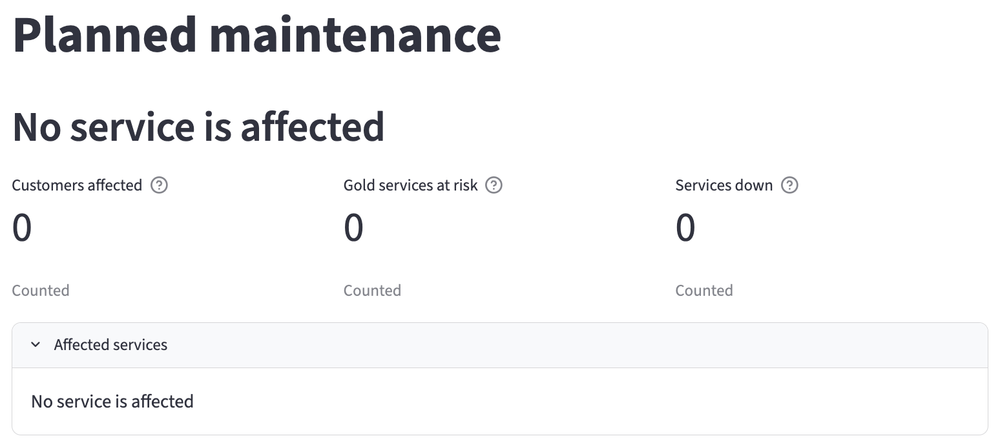

Select "Brussels switch 1 maintenance". The headline shows "1 Gold service for Helix Health has no path during this change". DI-2001 (Helix Health, Gold) has one path, through Brussels switch 1 and Brussels edge router 1, so the maintenance leaves it with none. DI-2003 (Silver) and DI-2005 (Bronze) are down as well.

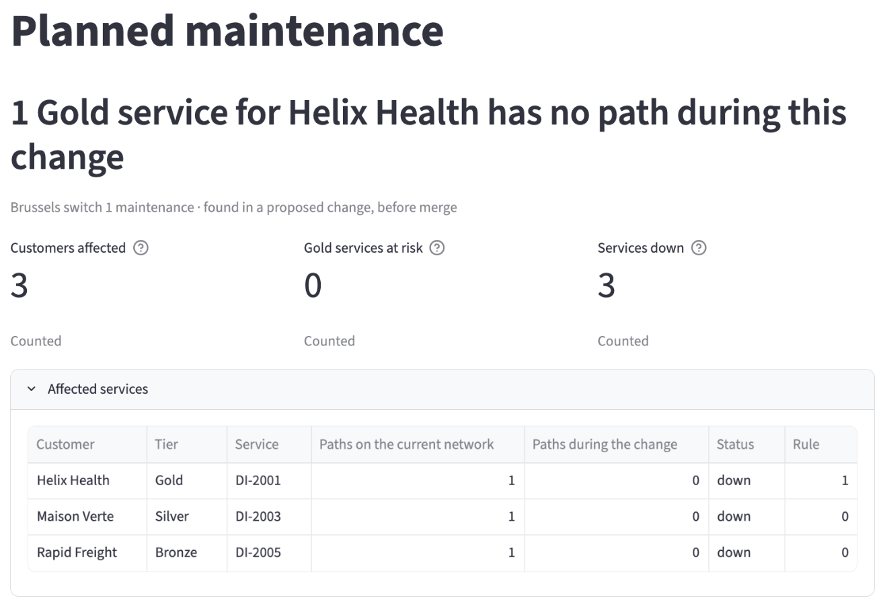

Select "New York router 1 maintenance". The headline shows "No service is affected", as on the current network.

## Step 4: read the guard result on the Paris plan

Open Infrahub at `http://localhost:8000` and sign in as `admin` / `infrahub`. Go to **Proposed Changes** and open "Paris router 1 maintenance". On the **Checks** tab, the Gold outage guard, listed as `gold_outage_guard`, has passed with this message:

> Paris router 1 maintenance leaves every active Gold service with at least 1 separate path.

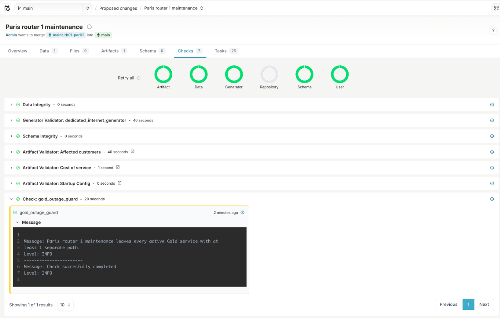

The check reads the same data as the Planned maintenance page. It counts the separate paths each active service keeps during the change and compares that number with the rule of the service's tier. The three Paris Gold services keep 1 path each, so the plan keeps the Gold rule and can merge.

## Step 5: read why the Brussels plan is blocked

Open "Brussels switch 1 maintenance". On the **Checks** tab, the Gold outage guard has failed with this message:

> Brussels switch 1 maintenance leaves 1 Gold service for Helix Health with no other path (DI-2001). It has 1 separate path on the current network and 0 during this change. Move this service to Brussels switch 2 first. Gold requires at least 1 separate path during a change, and this change leaves 0.

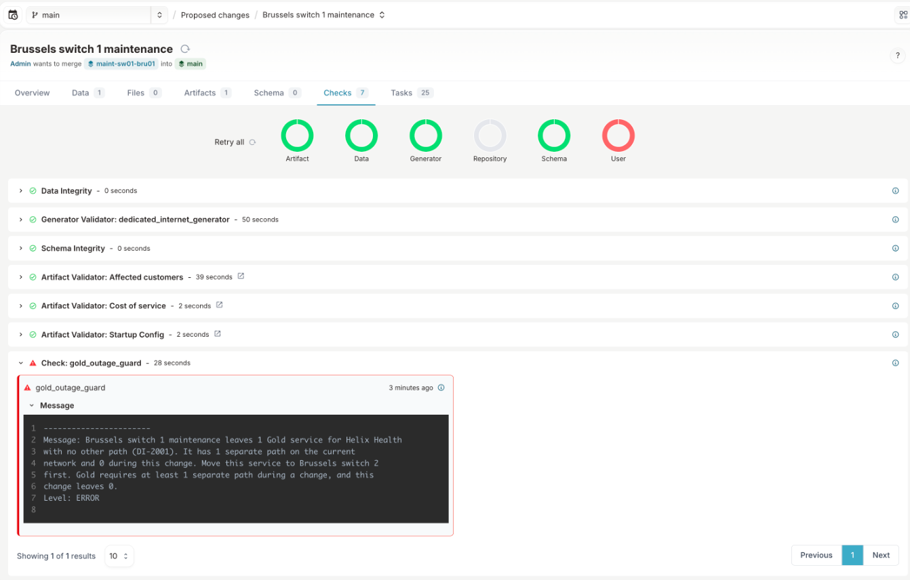

The message names the customer, the tier, the service, its paths before and after the change, and where to move it. Its last sentence states the Gold tier's rule and how many paths the plan leaves.

## Step 6: try to merge the blocked plan

Select **Merge** on the Brussels proposed change. Infrahub refuses with "Unable to merge proposed change containing failing checks", and Brussels switch 1 stays active on the current network.

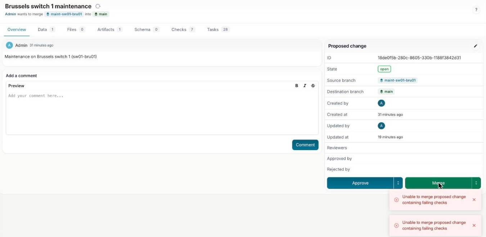

The Gold outage guard has no override. The plan can merge only after DI-2001 has a path that the change does not take out of service.

## Step 7: open a plan that affects no service

Open "New York router 1 maintenance". No active service runs through `rb01-nyc01`, so the Gold outage guard passes and does not block the merge.

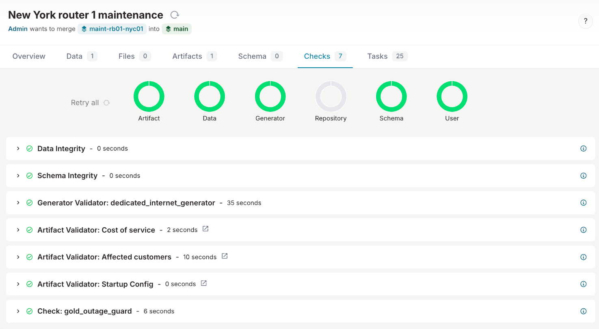

## Step 8: raise a tier rule and view the guard fail

Each service tier carries a rule: the minimum number of separate paths each of its active services keeps during a change. On the current network, Gold has 1, Silver 0 and Bronze 0. A change to a tier's rule is a change to a customer commitment, and you plan it in a proposed change in the same way as maintenance. In this step, you promise Silver customers two separate paths during a change, and the guard compares that promise with the network.

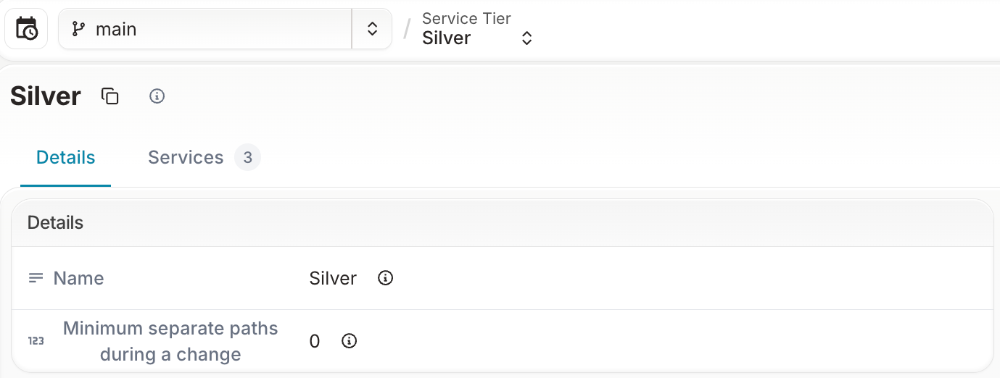

1. In Infrahub, create a branch named `raise-silver-rule`.
2. On that branch, open **Services**, then **Service Tiers**, and select Silver. Set **Minimum separate paths during a change** to 2 and save.
3. Open **Proposed Changes** and create a proposed change from `raise-silver-rule` to `main`, named "Promise two paths to Silver customers".

When the pipeline finishes, the Gold outage guard on the **Checks** tab has failed with this message:

> Promise two paths to Silver customers raises the Silver rule from 0 to 2 separate paths during a change, and 3 active Silver services have fewer (DI-1004, DI-1005, DI-2003: 1 each). Build the paths first, or keep the rule at 0.

Each Silver service has one path in the demo, so no Silver service meets the new rule. Select **Merge**. Infrahub refuses with "Unable to merge proposed change containing failing checks", and Silver keeps a rule of 0 on the current network.

The Gold outage guard applies the rule of every tier, not only Gold. It kept the name "Gold outage guard" from when only Gold had a rule.

## Step 9: view the record of the proposed change

Infrahub keeps the record an auditor needs for each proposed change: the plan, the guard result, the affected customers, and who approved and merged it, and when.

In the menu, select **Activity**, then **Activities**. Select **Related Node**, choose the kind **Proposed Change**, select "Paris router 1 maintenance" and select **Apply**. The list shows each event with its date, account and branch: the proposed change created by Admin, and each validator that started and passed, including the Gold outage guard and the "Affected customers" artifact.

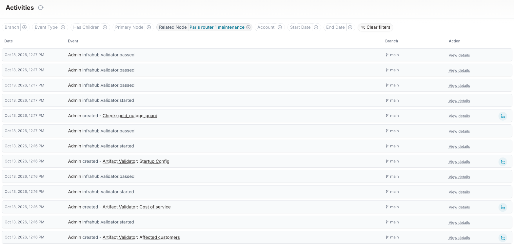

Infrahub does not let the account that opened a proposed change approve it. The seed step opened the plans as `admin`. To approve the Paris plan, sign out and sign in as `emma` / `infrahub`, the change manager account from the [installation guide](../getting-started/installation.mdx), and select **Approve**. **Approved by** on the proposed change then shows Emma, and the approval appears on the **Activities** page with its date. Selecting **Merge** sets Paris edge router 1 to maintenance on the current network, so do this step after the others.

The demo runs on Infrahub Community. Infrahub records Emma's approval and refuses an approval from the account that opened the proposed change, but does not require an approval before merge. Infrahub Enterprise can require approvals before merge.

Each service also records who requested it and why: open **Services**, then **Dedicated Internet**, and select DI-1001, where **Requested by** reads "Northbank network operations" and **Reason for the request** reads "Primary internet access for the Paris trading floor".

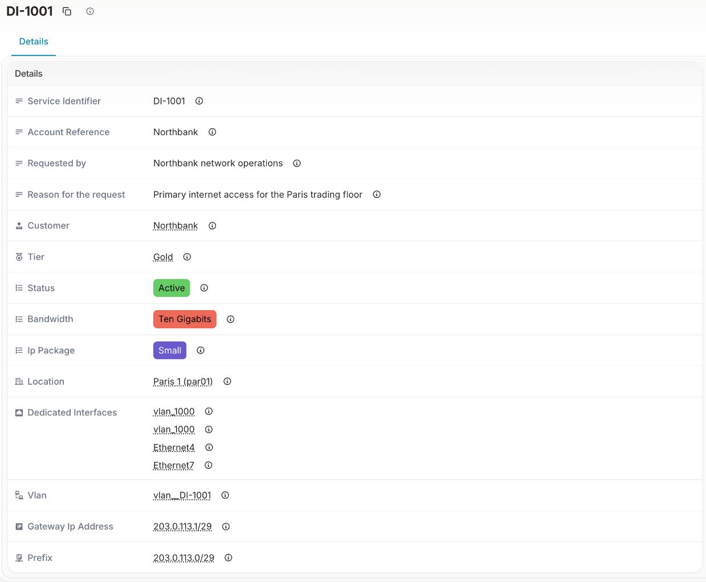

## Optional: change a device status yourself

On the branch of a proposed change, set another device to maintenance in the Infrahub UI, for example `rb01-bru01`. The Planned maintenance page caches its reads for 10 seconds, so the change shows on the first page refresh after that.

## What you did

You planned maintenance on Paris edge router 1. The Planned maintenance page showed that the three Paris Gold services keep one path each during the window, at risk, and that one Silver and one Bronze service go down. The Gold outage guard passed the Paris plan, because every Gold service keeps at least 1 separate path. It blocked the Brussels switch 1 plan, because DI-2001 has no other path, and Infrahub refused the merge. When you raised the Silver rule to 2 separate paths, the guard failed that proposed change too, because no Silver service has a second path. Infrahub keeps the record of each proposed change, with its checks, its validators and its approval.

The same chain, from the customer's commitment to the guard result:

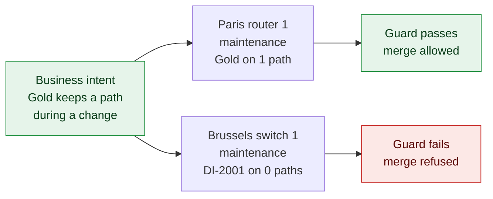
