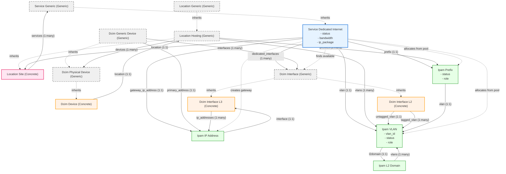
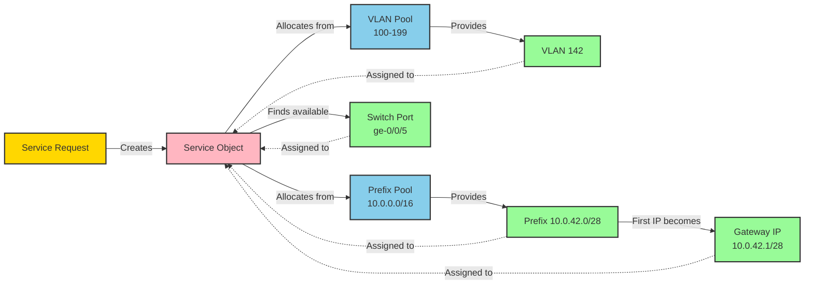
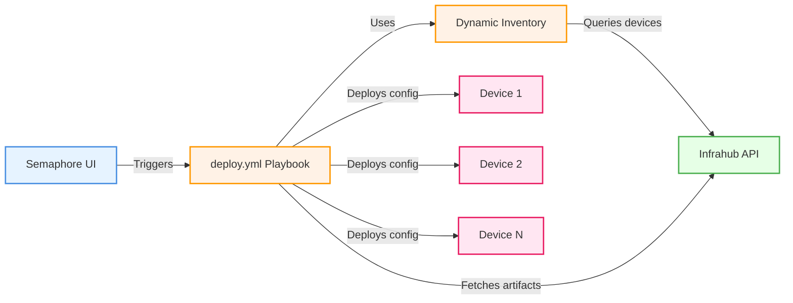
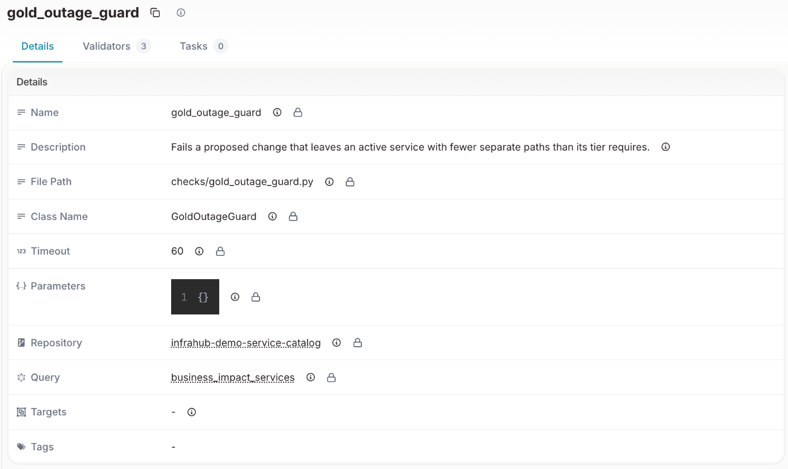

import ReferenceLink from "../../src/components/Card";

In this walkthrough, we detail the key building blocks of the demo, explain how it works, and describe how the components interact. This guide is intended for developers who want to understand the implementation details of the service catalog PoC.

<ReferenceLink title="Need help or have questions? Join our Discord community for support!" url="https://discord.gg/opsmill" openInNewTab/>

## The schema

To structure and store data, we define a schema in Infrahub. You can find the schema files in the `schemas` folder.

### Schema architecture overview

The following diagram illustrates the complete schema architecture, showing how different objects relate to each other in the Service Catalog demo:



#### Key concepts in the diagram

1. **Generic vs Concrete Objects**:
   - **Generic** (dashed boxes): Abstract base classes that define common attributes
   - **Concrete** (solid boxes): Actual objects that can be instantiated

2. **Object Categories**:
   - **Service Layer** (blue): Service definitions and instances
   - **Location Layer** (pink): Geographic hierarchy and hosting locations
   - **DCIM Layer** (orange): Physical devices and interfaces
   - **IPAM Layer** (green): Network resources (IPs, VLANs, prefixes)

3. **Relationship Types**:
   - **Inheritance** (dashed arrows): Shows class hierarchy
   - **Associations** (solid arrows): Shows data relationships with cardinality
   - **Resource Allocation** (dotted arrows): Shows dynamic provisioning flow

### Consuming the Infrahub Marketplace

Much of the schema is based on the [Infrahub Marketplace](https://marketplace.infrahub.app), which provides reusable schema components for quickly scaffolding a schema.

- `base`: Contains generic definitions for `IPAM` (IP address, prefix, etc.), `DCIM` (network device, interface, etc.), `location`, and `organization` (provider, manufacturer). Importing this folder is mandatory as it provides the basic definitions required for extensions.
- `location_minimal`: Defines a hierarchical tree for country, metro, and site.
- `vlan`: Includes nodes for VLANs and L2 domains.
- `circuit` (optional): Defines circuits with endpoints for site-to-site connections. This schema is available in `schemas/circuit/` but is not loaded by default. To load it with the repository, remove the `#` before `schemas/circuit` and `data/09_circuit.yml` in `.infrahub.yml`, and add `menu_circuit.yml` under `menus`: the circuit node types and the **Circuit** menu item then appear in Infrahub. `invoke seed` also loads the schema and the menu item, with the upstream circuits of the cost of service.

<ReferenceLink title="Learn about the Infrahub Marketplace" url="https://docs.infrahub.app/schema/marketplace" openInNewTab/>

### Custom service schema

The service layer is unique to each organization, so we define a custom schema to represent services and their components.

```yaml title="/schemas/service/service.yml"
---
# yaml-language-server: $schema=https://schema.infrahub.app/infrahub/schema/latest.json
version: "1.0"

generics:
  # To enable future expansions, we define a generic service object.
  # This object holds all common attributes shared across the services.
  # Relationships can point at this generic, so one relationship covers every service type.
  - name: Generic
    namespace: Service
    description: Generic service...
    label: Service
    icon: mdi:package-variant
    include_in_menu: false
    human_friendly_id:
      - service_identifier__value
    order_by:
      - service_identifier__value
    display_labels:
      - service_identifier__value
    attributes:
      - name: service_identifier
        kind: Text
        unique: true
        order_weight: 1000
        optional: false
        branch: agnostic
      - name: account_reference
        kind: Text
        order_weight: 1010
        optional: false
        branch: agnostic

nodes:
  # The DedicatedInternet schema node inherits from the generic service object and includes a few additional attributes.
  # These attributes are relatively high-level (e.g., an ip_package with T-shirt size values) and are primarily intended as inputs for users.
  - name: DedicatedInternet
    namespace: Service
    description: This service provides customers with a dedicated physical port, ensuring complete internet connectivity.
    label: Dedicated Internet
    icon: mdi:ethernet
    menu_placement: ServiceGeneric
    inherit_from:
      - ServiceGeneric
    include_in_menu: false
    # By default, Infrahub creates data within branches (parallel realities), but it also supports branch-agnostic objects.
    # A branch-agnostic object is propagated to all branches, regardless of where it was created.
    # Here, branch-agnostic behavior is applied in the schema to the service object and key attributes, such as service_identifier.
    # This ensures consistent tracking of a service across all ongoing implementations and branches.
    branch: agnostic
    attributes:
      - name: status
        kind: Dropdown
        optional: false
        default_value: draft
        order_weight: 1050
        # Putting this one as branch aware otherwise generator put it as active in the branch and so on main as well
        # even tho the service is really active only when the branch is merged...
        branch: aware
        choices:
          - name: draft
            label: Draft
            color: "#D3D3D3"
          - name: in-delivery
            label: In Delivery
            color: "#A8E6A2"
          - name: active
            label: Active
            color: "#66CC66"
          - name: in-decomissioning
            label: In Decomissioning
            color: "#FFAB59"
          - name: decomissioned
            label: Decomissioned
            color: "#FF6B6B"
      - name: bandwidth
        kind: Dropdown
        optional: false
        order_weight: 1100
        branch: aware
        choices:
          - name: "100"
            label: Hundred Megabits
            description: Provides a 100 Mbps bandwidth.
          - name: "1000"
            label: One Gigabit
            description: Provides a 1 Gbps bandwidth.
          - name: "10000"
            label: Ten Gigabits
            description: Provides a 10 Gbps bandwidth.
      - name: ip_package
        kind: Dropdown
        optional: false
        order_weight: 1120
        branch: aware
        choices:
          - name: small
            label: Small
            description: Provide customer with 6 IPs.
            color: "#6a5acd"
          - name: medium
            label: Medium
            description: Provide customer with 14 IPs.
            color: "#9090de"
          - name: large
            label: Large
            description: Provide customer with 30 IPs.
            color: "#ffa07a"
    # We implement various relationships to capture all the building blocks of the service (such as prefixes, interfaces, etc.)
    relationships:
      # From a site’s perspective, I only need a list of services and do not want multiple relationships for each type of service.
      # However, for a specific type of service, I want to enforce rules within the relationships.
      # For example, a distributed service could link to multiple sites, whereas a DedicatedInternet service is tied to a single site.
      # By configuring directions in relationships to point toward the generic service from a site’s perspective and initiating the relationship in the node pointing toward the site, we achieve the desired behavior.
      # Using the same identifier in the relationship allows Infrahub to recognize it as a single, unified relationship.
      - name: location
        peer: LocationSite
        order_weight: 1150
        cardinality: one
        direction: inbound
        identifier: service_site
        optional: false
        branch: agnostic
      - name: dedicated_interfaces
        peer: DcimInterface
        kind: Attribute
        order_weight: 1200
        cardinality: many
        direction: inbound
        identifier: service_interface
      - name: vlan
        peer: IpamVLAN
        kind: Attribute
        order_weight: 1300
        cardinality: one
        direction: inbound
        identifier: service_vlan
      - name: gateway_ip_address
        peer: IpamIPAddress
        order_weight: 1350
        cardinality: one
        direction: inbound
        identifier: service_ip_address
      - name: prefix
        peer: IpamPrefix
        kind: Attribute
        order_weight: 1400
        cardinality: one
        direction: inbound
        identifier: service_prefix

extensions:
  nodes:
    - kind: LocationSite
      relationships:
        - name: services
          peer: ServiceGeneric
          cardinality: many
          direction: outbound
          identifier: service_site
          branch: agnostic
    - kind: DcimInterface
      relationships:
        - name: service
          peer: ServiceGeneric
          cardinality: one
          direction: outbound
          identifier: service_interface
    - kind: IpamVLAN
      relationships:
        - name: service
          peer: ServiceGeneric
          cardinality: one
          direction: outbound
          identifier: service_vlan
    - kind: IpamIPAddress
      relationships:
        - name: service
          peer: ServiceGeneric
          cardinality: one
          direction: outbound
          identifier: service_ip_address
    - kind: IpamPrefix
      relationships:
        - name: service
          peer: ServiceGeneric
          cardinality: one
          direction: outbound
          identifier: service_prefix
    - kind: CoreProposedChange
      relationships:
        - name: tags
          peer: BuiltinTag
          cardinality: many
```

:::success

We now have the data model and data to support our use case. It captures everything from services to the backbone, with some abstraction for flexibility. This setup is a strong foundation for automation.

:::

<ReferenceLink title="Learn about Infrahub flexible schema" url="https://docs.infrahub.app/guides/create-schema" openInNewTab/>

## The generator

A generator creates the infrastructure objects that implement a service request. The rules for that implementation are written once, in Python, and Infrahub applies them the same way every time the generator runs.

:::important

We want to build the generator with the concept of **idempotency** in mind, meaning it should be repeatable: it assigns resources the first time it runs, and if run again, it changes nothing if the desired state is already achieved. This approach ensures the code is robust and predictable.

Infrahub provides a set of features to help:

- Resource manager: It allows users to create pools and allocate resources from them, such as prefixes, IP addresses, or even numbers. We will use this feature to allocate our prefixes/vlan in a branch-agnostic and idempotent way. Learn more about [resource managers](https://docs.infrahub.app/topics/resource-manager).
- `allow_upsert=True`: This parameter is provided when saving the node, allowing it to be created if it doesn't exist or updated if it does. This is useful for ensuring that the generator can run multiple times without creating duplicates or errors.

:::

```python title="/generators/implement_dedicated_internet.py"
from __future__ import annotations

import logging
import re
from typing import TYPE_CHECKING

from infrahub_sdk.generator import InfrahubGenerator
from infrahub_sdk.protocols import CoreIPPrefixPool, CoreNumberPool

if TYPE_CHECKING:
    from infrahub_sdk.node import InfrahubNode

try:
    # When imported as part of a package (e.g., within Infrahub)
    from .protocols import (
        DcimDevice,
        DcimInterfaceL2,
        DcimInterfaceL3,
        IpamIPAddress,
        IpamPrefix,
        IpamVLAN,
        ServiceDedicatedInternet,
    )
except ImportError:
    # When imported directly (e.g., in unit tests)
    from protocols import (  # type: ignore[no-redef]
        DcimDevice,
        DcimInterfaceL2,
        DcimInterfaceL3,
        IpamIPAddress,
        IpamPrefix,
        IpamVLAN,
        ServiceDedicatedInternet,
    )

ACTIVE_STATUS = "active"
FREE_STATUS = "free"
CORE_ROLE = "core"
EDGE_ROLE = "edge"
CUSTOMER_ROLE = "customer"

# The data the generator allocates from, by the names the object files give it. Renaming one of them in
# data/05_resource_pools.yml or data/03_ipam_domain.yml means changing it here too. A unit test checks
# that each name below exists in those files.
SERVICE_VLAN_POOL: str = "Customer vlan pool"
SERVICE_PREFIX_POOL: str = "Customer prefixes pool"
SERVICE_L2_DOMAIN: str = "default"

IP_PACKAGE_TO_PREFIX_SIZE: dict[str, int] = {"small": 29, "medium": 28, "large": 27}


def natural_key(name: str) -> tuple[int | str, ...]:
    """Sort key that puts Ethernet2 before Ethernet10."""
    return tuple(int(part) if part.isdigit() else part for part in re.split(r"(\d+)", name))


def _device_index(interface: InfrahubNode, role: str) -> int | None:
    """The index of the interface's device when the device has this role, or None.

    The device comes from the generator query result, which the SDK converts into SDK nodes.
    """
    if not interface.device.id:
        return None
    device = interface.device.peer
    index = device.index.value
    return int(index) if device.role.value == role and index is not None else None


def existing_core_ports(service: InfrahubNode) -> dict[int, DcimInterfaceL2]:
    """The service's port on each core switch, by switch index, from the generator query result.

    When a switch has more than one port of the service, the first one the query returns is kept.
    """
    ports: dict[int, DcimInterfaceL2] = {}
    for related in service.dedicated_interfaces.peers:
        interface = related.peer
        index = _device_index(interface, CORE_ROLE)
        if index is not None:
            ports.setdefault(index, interface)
    return ports


def gateway_router_index(service: InfrahubNode) -> int | None:
    """The index of the edge router whose interface holds the service's gateway IP address, or None."""
    if not service.gateway_ip_address.id:
        return None
    gateway_ip = service.gateway_ip_address.peer
    if not gateway_ip.interface.id:
        return None
    return _device_index(gateway_ip.interface.peer, EDGE_ROLE)


class DedicatedInternetGenerator(InfrahubGenerator):
    customer_service: ServiceDedicatedInternet
    allocated_vlan: IpamVLAN
    allocated_prefix: IpamPrefix
    gateway_ip: IpamIPAddress

    log = logging.getLogger("infrahub.tasks")

    async def generate(self, data: dict) -> None:  # noqa: ARG002 - the SDK passes `data` by name; the nodes are read
        # `convert_query_response` in .infrahub.yml makes the SDK convert the query result into nodes:
        # the service in `self.nodes`, and its ports, devices and gateway IP address in the client store.
        if not self.nodes:
            self.log.error("No Dedicated Internet service matches this run; nothing to provision.")
            return
        self.customer_service = self.nodes[0]

        # Move the service as active
        # TODO: Not happy with having this one here...
        self.customer_service.status.value = ACTIVE_STATUS
        await self.customer_service.save(allow_upsert=True)

        # Allocate the VLAN to the service
        await self.allocate_vlan()

        # Translate teeshirt size to int
        self.prefix_length: int = IP_PACKAGE_TO_PREFIX_SIZE[self.customer_service.ip_package.value]

        # Allocate the prefix to the service
        await self.allocate_prefix()

        # Allocate port
        await self.allocate_port()

        # Create L3 interface for gateway
        await self.allocate_gateway()

    async def allocate_vlan(self) -> None:
        """Create a VLAN with ID coming from the pool provided and assign this VLAN to the service."""
        self.log.info("Allocating VLAN to this service...")

        # Identity here is "one VLAN per service", not the VLAN's human-friendly identifier.
        # `vlan_id` is allocated from a CoreNumberPool and is part of the HFID, so it has no
        # concrete value until creation; `allow_upsert=True` therefore cannot resolve the HFID
        # (infrahub-sdk >= 1.10 raises a ValidationError). Reuse the existing VLAN on re-runs and
        # create with a plain save otherwise. See opsmill/infrahub-sdk-python#339 and #396.
        existing_vlans = await self.client.filters(
            kind=IpamVLAN,
            service__ids=[self.customer_service.id],
        )
        if existing_vlans:
            self.allocated_vlan = existing_vlans[0]
            # Saved, not just returned. A generator run's group holds what that run produced, and
            # Infrahub deletes members that a later run stops producing. Reading the VLAN back does
            # not put it in this run's group, so returning here left it out and the cleanup after the
            # next run deleted it -- the VLAN this branch exists to preserve. Every other allocation
            # below already re-saves on each run, which is why only this one was pruned.
            #
            # `allow_upsert=True` is safe here, unlike at creation: `vlan_id` is part of the HFID and
            # now holds the concrete value the pool allocated, so the HFID resolves.
            await self.allocated_vlan.save(allow_upsert=True)
            self.log.info(f"VLAN `{self.allocated_vlan.name.value}` already allocated to this service; reusing.")
            return

        # Get resource pool
        resource_pool = await self.client.get(
            kind=CoreNumberPool,
            name__value=SERVICE_VLAN_POOL,
        )

        # Craft and save the vlan
        self.allocated_vlan = await self.client.create(
            kind=IpamVLAN,
            name=f"vlan__{self.customer_service.service_identifier.value}",
            vlan_id=resource_pool,  # Here we get the vlan ID from the pool
            description=f"VLAN allocated to service {self.customer_service.service_identifier.value}",
            status=ACTIVE_STATUS,
            role=CUSTOMER_ROLE,
            l2domain=[SERVICE_L2_DOMAIN],
            service=self.customer_service,
            location=[self.customer_service.location.id],
        )

        # Plain create (not an upsert): the pool allocates a concrete vlan_id at creation time, and
        # idempotency on re-runs is handled by the lookup above.
        await self.allocated_vlan.save()

        self.log.info(f"VLAN `{self.allocated_vlan.name.value}` assigned!")

    async def allocate_prefix(self) -> None:
        """Allocate a prefix coming from a resource pool to the service."""
        self.log.info("Allocating prefix from pool...")

        # Get resource pool
        resource_pool = await self.client.get(
            kind=CoreIPPrefixPool,
            name__value=SERVICE_PREFIX_POOL,
        )

        # Craft the data dict for prefix. Relationship fields (`service`, `vlan`) are set below via
        # attribute assignment instead: the pool-allocation mutation's `data` input does not reliably
        # persist relationships, only plain attributes.
        prefix_data: dict = {
            "status": ACTIVE_STATUS,
            "description": f"Prefix allocated to service {self.customer_service.service_identifier.value}",
            "role": CUSTOMER_ROLE,
        }

        # Create resource from the pool
        self.allocated_prefix = await self.client.allocate_next_ip_prefix(
            resource_pool,
            kind=IpamPrefix,
            data=prefix_data,
            prefix_length=self.prefix_length,
            identifier=self.customer_service.service_identifier.value,
        )

        # Set the relationships explicitly; see comment above.
        self.allocated_prefix.service = self.customer_service
        self.allocated_prefix.vlan = self.allocated_vlan

        self.log.info(f"Prefix `{self.allocated_prefix}` assigned!")

        await self.allocated_prefix.save(allow_upsert=True)

    async def allocate_port(self) -> None:
        """Allocate a port to the service: the port it already has, or the first free port at its site."""
        self.log.info("Allocating port to this service...")

        core_ports = existing_core_ports(self.customer_service)
        allocated_port: DcimInterfaceL2
        if core_ports:
            # A service can have a port on each switch (a second path). A re-run keeps the first path:
            # the switch with the index of the edge router that holds the gateway IP, else the lowest index.
            gateway_index = gateway_router_index(self.customer_service) if len(core_ports) > 1 else None
            self.index = gateway_index if gateway_index in core_ports else min(core_ports)
            allocated_port = core_ports[self.index]
            self.log.info(f"Port `{allocated_port.display_label}` already allocated to the service.")
        else:
            self.log.info("Haven't found any port allocated to this service.")
            allocated_port = await self.free_port()
            self.log.info(f"Found port {allocated_port.display_label} to allocate to the service.")

        # Enforce all params of this interface
        allocated_port.enabled.value = True
        allocated_port.status.value = ACTIVE_STATUS
        allocated_port.l2_mode.value = "Access"
        allocated_port.role.value = CUSTOMER_ROLE
        allocated_port.description.value = f"Port allocated to service {self.customer_service.service_identifier.value}"
        allocated_port.speed.value = int(self.customer_service.bandwidth.value)
        allocated_port.service = self.customer_service
        allocated_port.untagged_vlan = self.allocated_vlan

        # Finally save. The port belongs to the switch, not to this generator: keep it out of the
        # tracking group, or a later run where the service uses another port would delete it.
        await allocated_port.save(allow_upsert=True, update_group_context=False)
        await self.release_port_from_group(allocated_port)
        await self.check_port_kept(allocated_port.id)

    async def free_port(self) -> DcimInterfaceL2:
        """The first free customer port at the service's site: lowest switch index first, then lowest port name.

        Infrahub filters the ports by role and status, so a port another service already took is not
        offered. Sets `self.index` to the switch index, which also picks the edge router of the gateway.
        """
        switches = await self.client.filters(
            kind=DcimDevice, location__ids=[self.customer_service.location.id], role__value=CORE_ROLE
        )
        indexed = sorted((int(switch.index.value), switch) for switch in switches if switch.index.value is not None)
        for index, switch in indexed:
            ports = await self.client.filters(
                kind=DcimInterfaceL2, device__ids=[switch.id], role__value=CUSTOMER_ROLE, status__value=FREE_STATUS
            )
            free: list[DcimInterfaceL2] = [port for port in ports if port.service.id is None]
            if free:
                self.index = index
                chosen: DcimInterfaceL2 = min(free, key=lambda port: natural_key(str(port.name.value)))
                return chosen

        identifier = self.customer_service.service_identifier.value
        msg = f"There is no physical port to allocate to customer on the core switches of the site of {identifier}"
        self.log.error(msg)
        raise RuntimeError(msg)

    async def check_port_kept(self, port_id: str) -> None:
        """Fail the run when another service took the port between the choice and the save.

        Two generator runs on the same branch can pick the same free port, and the last save wins. Reading
        the port back makes the run that lost fail with a message, instead of passing with a port it does
        not have; running the generator again picks another port. Runs on separate branches, as the portal
        creates them, do not see each other's ports: Infrahub shows two changes to the same port as a
        conflict in the proposed change of the second one.
        """
        port = await self.client.get(kind=DcimInterfaceL2, id=port_id)
        if port.service.id != self.customer_service.id:
            msg = (
                f"Port {port.display_label} was allocated to another service during this run. Run the generator again."
            )
            self.log.error(msg)
            raise RuntimeError(msg)

    async def release_port_from_group(self, port: InfrahubNode) -> None:
        """Take the port out of this generator's tracking group if an earlier run put it there.

        Earlier versions of this generator saved the port inside the group. At the end of the run the SDK
        deletes every member the run did not save, so it would delete the switch port of an existing service.
        """
        group = await self.client.group_context.get_group()
        if group is None or port.id not in group.members.peer_ids:
            return
        self.log.info(f"Removing port {port.display_label} from the generator group {group.display_label}")
        group.members.remove(port.id)
        await group.save(update_group_context=False)

    async def allocate_gateway(self) -> None:
        """Allocate a gateway to the service."""
        self.log.info("Allocating gateway to this service...")

        # Find the corresponding router
        router = await self.client.get(
            kind=DcimDevice,
            location__ids=[self.customer_service.location.id],
            role__value=EDGE_ROLE,
            index__value=self.index,
        )

        # Create interface
        gateway_interface = await self.client.create(
            kind=DcimInterfaceL3,
            name=f"vlan_{self.allocated_vlan.vlan_id.value}",
            speed=1000,
            device=router,
            status=ACTIVE_STATUS,
            role=CUSTOMER_ROLE,
            description=f"Gateway interface for service {self.customer_service.service_identifier.value}",
            enabled=True,
            service=self.customer_service,
        )
        await gateway_interface.save(allow_upsert=True)

        # Compute the gateway ip
        address: str = f"{next(self.allocated_prefix.prefix.value.hosts())!s}/{self.prefix_length!s}"

        # Create the IP object. Its `service` relationship is the service's `gateway_ip_address`: the
        # authoritative link from a service to its gateway. The prefix's `gateway` below points to the same
        # IP address for IPAM views; the generator sets both from the same node on each run.
        self.gateway_ip = await self.client.create(
            kind=IpamIPAddress,
            address=address,
            service=self.customer_service,
            interface=gateway_interface,
        )
        await self.gateway_ip.save(allow_upsert=True)

        self.log.info(f"Gateway `{self.gateway_ip.address.value}` assigned!")

        # Add gateway to prefix
        self.allocated_prefix.gateway = self.gateway_ip

        # Save prefix
        await self.allocated_prefix.save(allow_upsert=True)
```

### Generator architecture patterns

1. **Resource Tracking**: Every allocation linked to the service
2. **Relationship Integrity**: Bi-directional references maintained
3. **Error Handling**: Fail fast with clear messages
4. **Logging**: Detailed progress tracking for troubleshooting
5. **Query result as SDK nodes**: The generator definition sets `convert_query_response: true` in `.infrahub.yml`. The SDK converts the query result into nodes, so the generator reads the service's ports and gateway from the result without another query. The query selects `id` and `__typename` on every node for this.
6. **Same port on every run**: A new service gets the free customer port with the lowest name on the core switch with the lowest index at its site. A service that already has a port keeps it. Two requests on separate branches that take the same port show as a conflict in the second proposed change.

### Service provisioning flow

Here's a focused view of how resources flow during service provisioning:



### Summary: From request to reality

The generator transforms a service request:

```yaml
Service: DI-12345
Location: Paris
Bandwidth: 1 Gbps
IP Package: Medium
```

Into fully provisioned infrastructure:

- VLAN 142 allocated and configured
- IP prefix 10.0.42.0/28 assigned
- Switch port ge-0/0/5 configured
- Router interface vlan_142 with IP 10.0.42.1/28

The generator is idempotent: running it again on the same service reuses these allocations.

<ReferenceLink title="Learn about Infrahub generators" url="https://docs.infrahub.app/topics/generator" openInNewTab/>

## The service portal architecture

### Streamlit for the user interface

The demo uses [Streamlit](https://streamlit.io/) for the user interface because it:

- Builds web UIs with pure Python (no JavaScript required)
- Provides ready-made components for forms and data display
- Calls the Infrahub Python SDK directly from the page code
- Enables rapid prototyping of service catalogs

### Portal design patterns

#### Infrahub SDK integration

The portal uses several patterns to efficiently interact with Infrahub:

```python title="Client Caching Pattern"
@st.cache_resource
def get_client(branch: str = "main") -> InfrahubClientSync:
    """Create and cache Infrahub client."""
    address = get_instance_address()
    return InfrahubClientSync(
        address=address,
        config=Config(default_branch=branch)
    )
```

:::tip Why Cache the Client?
The `@st.cache_resource` decorator:

- Creates client once and reuses it
- Reduces connection overhead
- Maintains consistent state
- Improves page load performance
:::

<ReferenceLink title="Learn about Streamlit" url="https://streamlit.io/" openInNewTab/>

## The deployment layer

### Semaphore for Ansible automation

[Semaphore](https://semaphoreui.com/) (SemaphoreUI) is an open-source web UI for running Ansible playbooks. In this demo, it serves as the deployment step: after a service is provisioned in Infrahub and the proposed change is merged, Semaphore runs playbooks that fetch the generated device configurations and deploy them to network equipment.



### Dynamic inventory

The inventory file (`ansible/inventory.yml`) uses the `opsmill.infrahub.inventory` plugin to build the device inventory dynamically from Infrahub at runtime. Instead of maintaining a static list of hosts, the plugin queries Infrahub for all `DcimDevice` nodes and composes host variables from their attributes:

```yaml title="ansible/inventory.yml"
plugin: opsmill.infrahub.inventory
api_endpoint: "http://infrahub-server:8000"

nodes:
  DcimDevice:
    include:
      - name
      - location.name
      - role
      - device_type.name
      - primary_address.address
      - status

compose:
  hostname: name
  ansible_host: primary_address.address | ansible.utils.ipaddr('address')
  platform: device_type.platform.ansible_network_os
  location: location.name
```

Any device added or modified in Infrahub appears in the Ansible inventory on the next run, because the inventory is read from Infrahub each time.

### The deployment playbook

The `ansible/deploy.yml` playbook performs two tasks per device:

1. **Fetch configuration artifact**: uses `opsmill.infrahub.artifact_fetch` to retrieve the `startup-config` artifact from Infrahub, identified by the device's node ID
2. **Save configuration**: writes the fetched configuration to a local file (`/tmp/<hostname>_startup_config.txt`)

```yaml title="ansible/deploy.yml"
- name: Deploy configuration to network devices
  hosts: all
  connection: local
  gather_facts: false

  tasks:
    - name: "Fetch configuration artifact from Infrahub"
      opsmill.infrahub.artifact_fetch:
        artifact_name: "startup-config"
        target_id: "{{ id }}"
      register: artifact

    - name: Save configs to localhost
      ansible.builtin.copy:
        content: "{{ artifact.text }}"
        dest: "/tmp/{{ inventory_hostname }}_startup_config.txt"
```

### Semaphore container setup

The Semaphore container (`semaphore/Dockerfile`) extends the official image with the dependencies needed to interact with Infrahub:

- **infrahub-sdk**: Python SDK installed via pip, required by the Ansible collection
- **`opsmill.infrahub` collection**: Ansible collection installed via `ansible-galaxy`, providing the `inventory` plugin and `artifact_fetch` module

At runtime, the container mounts the `ansible/` directory as its playbook source, so any changes to playbooks or inventory are reflected immediately without rebuilding.

## The business impact layer

In the business impact layer, business context is stored in the same graph that provisioning uses. Several parts read it: four pages in the portal, a check in the proposed change pipeline, two artifacts and a webhook. A seed task loads the demo data. For the concepts, see [Business impact](../business-impact/overview.mdx).

### What runs in Infrahub and what runs in the portal

The Planned maintenance, Single points of failure, Customer notification and Cost of service pages are part of a small Streamlit app in this repository, not screens that Infrahub provides. They read stored queries and artifacts from Infrahub and draw the figures. Infrahub holds the data, enforces the rule, generates the artifacts and sends the webhook.

In Infrahub:

- Customers and tiers, linked to the services and to the switches and edge routers they run on
- The list price of each device type and the monthly cost of each upstream circuit, the demo inputs of the cost of service
- Each maintenance plan, on its own branch with a proposed change
- The stored queries `business_impact_services` and `cost_of_service`, which the pages read through the Infrahub API
- The Gold outage guard, a check written in Python in this repository. Infrahub runs it in every proposed change pipeline, refuses the merge while it fails, and keeps the record of the approval and the merge
- Three Python transforms: `affected_customers` and `cost_of_service`, which produce the "Affected customers" and "Cost of service" artifacts, and `outreach_payload`, which builds the body of the `gold-outreach` webhook
- The `gold-outreach` webhook, which sends the at-risk Gold customers of a new proposed change to a CRM
- The generator that allocates each service's VLAN, prefix, switch port and gateway

In the portal:

- The service request form
- The Planned maintenance and Single points of failure pages: the headlines, tiles and tables
- The Customer notification page, which shows the "Affected customers" artifact of a proposed change
- The Cost of service page, which shows the cost figures and offers the "Cost of service" artifact as a CSV download

The pages only read from Infrahub. The figures come from Python in this repository, in `service_catalog/business_impact/` and `service_catalog/cost_of_service/`. The pages, the guard and the transforms use the same code, so they report the same services. Your own portal, ITSM tool or reporting tool can read the same stored queries and artifacts and show the same figures.

### Schema additions

Two nodes, one report node and four fields store the business context and the cost inputs:

- `ServiceTier` (`schemas/service/tier.yml`): Gold, Silver and Bronze, each with `min_paths`, the minimum number of separate paths its active services keep during a change
- `OrganizationCustomer` (`schemas/base/organization.yml`): a customer, which inherits `OrganizationGeneric` beside manufacturers and providers. Its name must be unique across all organizations
- On `ServiceGeneric`: a `customer` and a `tier` relationship, both optional and branch-aware. Branch-aware means you can change them in a proposed change without changing `main`
- `list_price` on `DcimDeviceType` (`schemas/base/dcim.yml`): the one-time list price of one device of the type, a demo input
- `monthly_cost` on `DcimCircuit` (`schemas/circuit/circuit.yml`): what the provider charges for the circuit each month, a demo input. The circuit schema stays optional in `.infrahub.yml`; `invoke seed` loads it with the upstream circuits, and endpoint A of each upstream circuit connects to `Ethernet4` of its edge router
- `ServiceReport` (`schemas/service/report.yml`): the target of the two report artifacts. `data/11_reports.yml` creates "Affected customers" and "Cost of service"

```yaml title="schemas/service/service.yml (excerpt)"
      - name: customer
        peer: OrganizationCustomer
        kind: Attribute
        cardinality: one
        optional: true
        identifier: service__customer
        branch: aware
```

Infrahub loads the three tiers and four customers from `data/10_customers_tiers.yml`, and the list prices from `data/06_device_type.yml`. `invoke seed` loads the circuit schema and the eight upstream circuits from `data/business_impact/upstream_circuits.yml`, which `.infrahub.yml` does not list. `data/08_device.yml` adds friendly descriptions such as "Paris edge router 1" to the Paris and Brussels devices.

### Two stored queries

`service_catalog/queries/business_impact_services.gql` is registered in `.infrahub.yml` as `business_impact_services`. It reads each Dedicated Internet service with its site, customer and tier, every switch and edge router with its site, status and index, and the tiers. Run on a proposed change's branch and on `main`, its results and the path traversal below show which services a change puts at risk or takes out of service.

`service_catalog/queries/cost_of_service.gql` is registered as `cost_of_service`. It reads each service with its site and bandwidth, each switch and edge router with its device type's list price and its number of interfaces with status active, and each edge router with its upstream interfaces and the ID of the endpoint connected to each. The active upstream interfaces carry a share of the router's list price that no service carries, and the endpoint gives the circuit of an edge router that carries no service path. The stored query names no circuit type, because the repository import refuses a stored query that names a type the loaded schema does not have.

`service_catalog/queries/cost_of_service_circuits.gql` reads each circuit with its site and monthly cost, and each circuit endpoint ID with its circuit, which matches the endpoint connected to an edge router's upstream interface. It is not registered in `.infrahub.yml`. The cost transform and the Cost of Service page run it only when the branch's schema has `DcimCircuitEndpoint`. Without the circuit schema, the figures cover the hardware cost only.

### How the code finds the paths of a service

Infrahub path traversal is the one way the demo finds the devices and circuits a service's paths go through. `service_footprints` in `service_catalog/business_impact/footprint.py` calls `traverse_paths` in the Infrahub SDK for each active service. The result is the service's footprint:

- **Devices**: from the service to each switch and edge router at its site, at most two relationships deep (service, interface, device). The kind filter allows `ServiceDedicatedInternet`, `DcimInterfaceL2`, `DcimInterfaceL3` and `DcimDevice`, passed as the generated protocol classes of `service_catalog/protocols_async.py`. A device is in the footprint when the traversal finds a path to it.
- **Circuits**: only when the circuit schema is loaded, from the service to each upstream circuit at its site, at most five relationships deep (service, gateway interface, edge router, upstream interface, circuit endpoint, circuit). The kind filter allows `ServiceDedicatedInternet`, `DcimInterfaceL3`, `DcimDevice`, `DcimCircuitEndpoint` and `DcimCircuit`. The footprint keeps each circuit it reaches with the edge router on the path.

The calls run at the same time, at most eight at once. `with_footprints` adds the footprints to the query result, and the Gold outage guard, the business impact pages, the "Affected customers" and outreach transforms and the cost of service read the devices and circuits of each service from there. A path is the route a service's traffic takes through the network at a site: it enters through a switch port, goes through a switch, and leaves through the edge router with the same number. `network.pair_paths` builds the paths by pairing each switch in the service's footprint with the edge router of the same number at the same site.

### The business impact pages

The portal entry point `service_catalog/portal.py` groups the pages in the sidebar into two sections, **Service catalog** and **Business impact**, from the list in `service_catalog/navigation.py`. Each page has its own URL: `/planned-maintenance`, `/single-points-of-failure`, `/customer-notification` and `/cost-of-service`.

`service_catalog/views/3_📊_Planned_Maintenance.py` and `service_catalog/views/6_📍_Single_Points_of_Failure.py` are read-only pages. They contain layout only. The reads and the copy are in `service_catalog/business_impact/page_views.py`; the figures come from `service_catalog/business_impact/blast_radius.py`, so unit tests cover every figure. The Planned maintenance page shows which services and customers a proposed change puts at risk or takes down, with their separate paths before and during the change.

The Single points of failure page comes from `service_catalog/business_impact/single_points.py`. It reads the same stored query on `main` only. `single_points` counts the active Gold services with a single point of failure and lists the devices on every path of each one. `with_device_failed` copies the query result with one device set to not active, and `build_blast_radius` builds the tiles and tables of the Planned maintenance page from that copy.

`service_catalog/views/4_📣_Customer_Notification.py` computes the affected customers of the selected proposed change with `change_impact.read_affected_report`, the function behind the "Affected customers" artifact, and groups them by status with `service_catalog/business_impact/notification_view.py`. It then reads the artifact on the change's branch and compares the two with `notification_view.file_notice`. The artifact can be missing, failed, the copy from `main` (whose `branch` field is `main`, until Infrahub generates the artifact on the branch), or older than the live list, for example after a merge into `main`. In each case the page says so and shows a **Regenerate** button.

`service_catalog/views/5_💶_Cost_of_Service.py` reads the `cost_of_service` query and the circuit query on `main`, adds the footprints with `service_catalog/cost_of_service/circuits.py` (`add_footprints`), and computes its figures with `service_catalog/cost_of_service/cost.py`, the same functions the "Cost of service" artifact uses. The download button serves the artifact that Infrahub generated. The page compares that CSV with the CSV of its own figures (`view.csv_is_current`), because a change to a circuit does not regenerate the artifact, and shows a **Regenerate** button when they differ. The chart and table rows come from `service_catalog/cost_of_service/view.py`.

Both buttons call `service_catalog.artifact_view.render_regenerate`, which calls `infrahub.generate_artifact`. It sends `POST /api/artifact/generate/<definition id>?branch=<branch>`, then reads the artifact every two seconds until it is Ready with a new checksum, for at most a minute. Infrahub answers the request as soon as it queues the generation, so the page cannot rely on the answer alone.

### The Gold outage guard check

`checks/gold_outage_guard.py` is registered under `check_definitions` in `.infrahub.yml` and runs in every proposed change pipeline. It runs the same stored query on the branch and on `main`, adds the footprint of each active service on each side, and reuses the logic in `blast_radius.py`. The rule comes from `ServiceTier.min_paths`, the minimum number of separate paths each active service of the tier keeps during a change; the demo data sets Gold to 1, and Silver and Bronze to 0. A service depends on the devices in its footprint, and has as many separate paths as its footprint has switch and edge router pairs with no device out of service. When a traversal fails, the check logs an error and fails. It fails when the change leaves an active service with fewer separate paths than its tier's rule, either by setting a device on its path to not active or by deleting a device, switch port or gateway interface on its path. It also fails when the change raises a tier's `min_paths` while active services of that tier have fewer separate paths than the new value. Infrahub does not merge a proposed change while a check has failed. It has no override.

#### How the check imports shared code

Infrahub runs a check from a copy of the repository at the commit of the proposed change, and imports the check file as `commits.<sha>.checks.gold_outage_guard`. Only the repository directory is on the Python path, and `service_catalog` is not installed in the stock Infrahub image, so `import service_catalog` fails inside the check.

The check imports the shared code relative to its own package instead, from the same commit. It uses `load` in `transforms/worktree.py`, the helper the transforms use, and takes the stored query's name from the module it loads:

```python title="checks/gold_outage_guard.py (excerpt)"
try:
    # Infrahub imports this file as `commits.<sha>.checks.gold_outage_guard`.
    from ..transforms.worktree import IMPACT_MODULE, load  # noqa: TID252 - the commit worktree import
except ImportError:
    # Imported on its own, as `checks.gold_outage_guard`.
    from transforms.worktree import IMPACT_MODULE, load


def load_impact() -> ModuleType:
    """The module that runs the guard, from this file's commit worktree."""
    module: ModuleType = load(IMPACT_MODULE)
    return module


class GoldOutageGuard(InfrahubCheck):
    query = load_impact().QUERY_NAME
```

```python title="transforms/worktree.py (excerpt)"
def load(module: str) -> ModuleType:
    """Import `module` from this file's commit worktree, or by its absolute name."""
    worktree_package = (__package__ or "").rpartition(".")[0]
    name = f"{worktree_package}.{module}" if worktree_package else module
    return importlib.import_module(name)
```

`service_catalog/business_impact/change_impact.py` reads the stored query on the branch and on `main`, adds the footprints and applies the rule. The check always runs the rule from its own commit. When the file is imported on its own, in unit tests or with `infrahubctl check`, `load` falls back to the absolute module name. `change_impact.py` imports the rule, `footprint.py`, `blast_radius.py` and `service_catalog/network.py` relatively for the same reason, and `footprint.py` imports `service_catalog/protocols_async.py` relatively too. Apply the same pattern when a check of your own needs code that lives outside `checks/`.

### The transforms, artifacts and webhook

Three Python transforms are registered under `python_transforms` in `.infrahub.yml`. They import the shared code from their own commit through the same `load` helper as the check. The `affected_customers` and `outreach_payload` transforms run the guard through `service_catalog/business_impact/change_impact.py`, the module the check uses, and take their query name from its `QUERY_NAME`.

Each transform has a `watch` list in `.infrahub.yml`: the repository files it imports or reads besides its own file. Infrahub only reads the transform's own file to find what it depends on. With the list, a commit that changes one of these files generates the artifact again, and a commit that changes none of them, such as a documentation change, does not. The `cost_of_service` list includes `service_catalog/queries/cost_of_service_circuits.gql`, the circuit query the transform reads from disk. Each of the three lists includes `service_catalog/business_impact/footprint.py` and `service_catalog/protocols_async.py`, because each transform finds the paths of the services with them. When you add an import or a file read to a transform, add the file to its `watch` list.

- `affected_customers` (`transforms/affected_customers.py`) produces the "Affected customers" artifact, JSON, for the `ServiceReport` named "Affected customers". Infrahub generates the artifact on each branch, so each proposed change has its own list on its source branch, regenerated by its pipeline. The transform runs the Gold outage guard on the branch as the check does, and `service_catalog/business_impact/notification.py` gives each affected customer a status.
- `cost_of_service` (`transforms/cost_of_service.py`) produces the "Cost of service" artifact, CSV, on `main`, with one row per service, path and part.
- `outreach_payload` (`transforms/outreach_payload.py`) builds the body of the `gold-outreach` webhook. Infrahub calls it with the creation event of a proposed change. It reads the source branch from the event, runs the guard on that branch, and returns the at-risk Gold customers, or `blocked: true` and no customer when the guard would fail.

The `gold-outreach` webhook is a custom webhook on the event `infrahub.node.created` for the node kind `CoreProposedChange`, on the default branch, with the transformation `outreach_payload`. [Notify the Gold customers a change puts at risk](../business-impact/notify-gold-customers.mdx) shows its settings and payload.

### The seed task

`invoke seed` (`service_catalog/business_impact/seed.py`) first sets the description that the Infrahub web interface shows for the check, the generator, the artifact definitions and the stored queries. `.infrahub.yml` has a `description` key only for transforms, so the texts sit in `REPOSITORY_DESCRIPTIONS` in `seed.py`. A repository import does not change them.



The seed then creates twelve services on `main` and runs the provisioning generator for each, so the seeded services look like ordered ones. It pins each service to a switch by linking one free customer port before the generator runs; the generator reuses that port and picks the edge router with the same index.

It then gives the three Paris Gold services, DI-1001, DI-1002 and DI-1003, a second path: a free customer port on the other Paris switch, and a gateway interface `vlan_<vlan id>` with status active and no IP address on the other Paris edge router. The order form and the generator stay single path.

It regenerates the "Cost of service" artifact on `main`, creates the `gold-outreach` webhook inactive with the placeholder URL `https://crm.example.com/api/campaigns`, and opens three maintenance proposed changes: Paris router 1, Brussels switch 1 and New York router 1. It waits for each pipeline and reports the guard result it expects: passed for Paris and New York, failed for Brussels.

## Architecture takeaways

### Key design decisions

1. **Schema as Foundation**: Well-designed schema enables everything else
2. **Automation through Generators**: Complex provisioning made straightforward
3. **Resource Management**: Centralized pools prevent conflicts
4. **Branch-Based Workflows**: Safe testing and rollback capabilities
5. **User-Friendly Abstractions**: Hide complexity behind clear choices
6. **Deployment Automation**: Semaphore bridges the gap between source of truth and network devices, using dynamic inventory and artifact-based configuration delivery
7. **Business Context in the Same Graph**: customers and tiers link to the same services and devices, so one stored query serves the pages, a merge-blocking check, an artifact and a webhook

### Extending the demo

Consider these enhancements for production use:

- Additional service types (MPLS, Cloud Connect, etc.)
- Approval workflows with human checkpoints
- Integration with ITSM platforms
- Automated testing of provisioned services
- Rollback and decommissioning automation
- Event-driven deployment: trigger Semaphore runs automatically when proposed changes are merged in Infrahub

## Next steps

Now that you understand the architecture:

1. **Run the Demo**: Follow the [installation guide](installation) to set up locally
2. **Try the Portal**: Walk through the [user experience](user-walkthrough)
3. **Explore Further**: Modify the schema or create new service types
4. **Build Your Own**: Apply these patterns to your infrastructure needs

With a schema that models your services, generators that implement them, and a Python portal for requests, you can build service automation that fits your own catalog.
